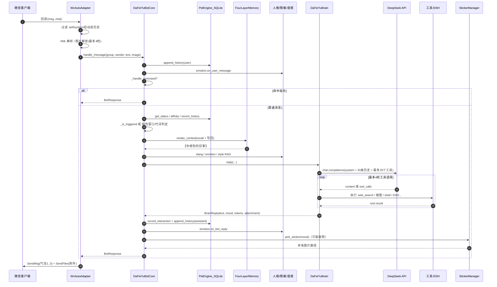
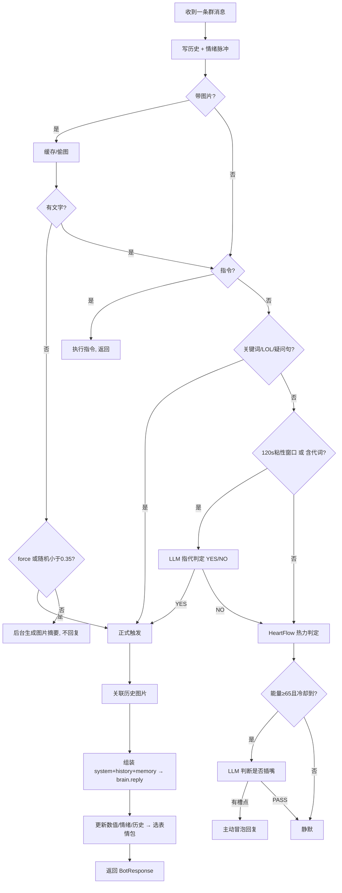
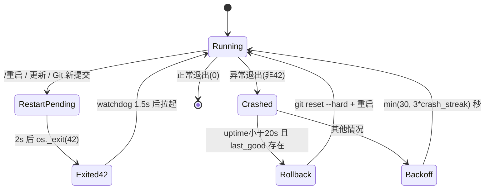

# 大肥鱼微信机器人项目代码结构分析

> **分析对象**：`C:\dafeiyu-wechat-bot-package\dafeiyu-wechat-bot`
> **代码版本**：`main` 分支 `94a2f5e`（`fix(dsh): omit --session-id for new sessions and auto-retry on missing session`）
> **分析时间**：2026-11-25
> **规模**：26 个 Python 文件、共 8,217 行（非空行 7,221）；`data/` 下 SQLite 已有 889 条聊天记录、32 张图片、14 个群友好感度档案、累计 1,644,367 Token
> **分析方法**：全量静态阅读 + `data/`、`state/`、`wechatauto_logs/` 运行数据交叉核对；未启动真实微信/QQ 会话，未调用线上模型

---

## 目录

1. [项目概览与结论先行](#1-项目概览与结论先行)
2. [目录结构与文件清单](#2-目录结构与文件清单)
3. [核心模块逐一分析](#3-核心模块逐一分析)
   - 3.1 [启动入口与运行模式](#31-启动入口与运行模式)
   - 3.2 [配置系统](#32-配置系统)
   - 3.3 [消息收发链路：适配器层](#33-消息收发链路适配器层)
   - 3.4 [消息编排核心 bot_core](#34-消息编排核心-bot_core)
   - 3.5 [大脑与推理逻辑 brain](#35-大脑与推理逻辑-brain)
   - 3.6 [人格系统与运行时情绪](#36-人格系统与运行时情绪)
   - 3.7 [记忆系统与识海](#37-记忆系统与识海)
   - 3.8 [养成数值引擎 pet_engine](#38-养成数值引擎-pet_engine)
   - 3.9 [工具能力：看图、联网、搜图、表情包](#39-工具能力看图联网搜图表情包)
   - 3.10 [插件系统的真实形态](#310-插件系统的真实形态)
   - 3.11 [定时任务调度](#311-定时任务调度)
   - 3.12 [DSH 后台任务对接](#312-dsh-后台任务对接)
   - 3.13 [自愈、重启与守护](#313-自愈重启与守护)
   - 3.14 [Web 控制台与 QQ 反向 WS](#314-web-控制台与-qq-反向-ws)
4. [关键调用链路](#4-关键调用链路)
5. [代码结构上的优点](#5-代码结构上的优点)
6. [耦合点、重复代码与隐患](#6-耦合点重复代码与隐患)
7. [可落地的改进建议（按优先级）](#7-可落地的改进建议按优先级)
8. [附录](#8-附录)

---

## 1. 项目概览与结论先行

### 1.1 项目定位

这是一个面向 **Windows 本地运行** 的「微信群 AI 宠物/群友」机器人，核心卖点不是通用客服，而是：

- **养成**：饱食度、心情、等级、群友好感度、投喂排行，聊天消耗的 Token 折算成“吃白饭”；
- **人格**：内置「峰哥亡命天涯」「塔菲大肥鱼」两套人设，支持群内热切换、自我进化、语感 RAG；
- **记忆**：L0 人设 / L1 识海图谱 / L2 日记周结 / L3 会话历史四层结构；
- **群聊能力**：看图锐评、OCR/截图解析、联网搜索、联网搜图、表情包、定时提醒、主动冒泡；
- **重任务**：把耗时编程/多文件任务异步丢给 DSH（DeepSeek Harness）CLI 后台进程；
- **自运维**：Git 自动更新、语法校验失败回滚、看门狗拉起、源码自修改。

一句话概括架构：**薄适配器 + 胖核心（bot_core）+ 单一推理门面（brain）+ 若干领域单例 + 一个寄生在微信适配器里的后台循环**。分层意识是有的，但 `bot_core` 与 `WxAutoAdapter` 承担了过多职责，导致“换通道 / 换部署形态”时后台能力会整体缺失。

### 1.2 结论先行

| # | 结论 | 依据 |
|---|---|---|
| 1 | 业务分层清晰，但 `bot_core.py` 是典型的 God Object（1008 行、直接依赖 13 个本地模块），指令、触发、编排、持久化、表情包、DSH、安全确认全塞在一个类里 | `bot_core.py:141-1008` |
| 2 | 真正的“后台循环”（定时任务、主动冒泡、DSH 结果投递、Git 自动更新）只存在于 `WxAutoAdapter.run_forever`；`web`、`qq`、`ilink` 模式下这些能力全部不工作 | `adapters/wxauto_adapter.py:350-453`；全仓仅此一处调用 `pop_due_tasks/check_autonomous_heartbeat/pop_finished_jobs/check_remote_update` |
| 3 | 安全默认值是**危险**的：`OWNER_NAMES` 为空时 `is_owner()` 对所有人返回 True，而当前 `.env` 正好为空；高危确认码又允许“群内任意成员”批准 | `agent_tools.py:37-48`、`safety_guard.py:280`、`bot_core.py:575-592` |
| 4 | 同步阻塞调用大量存在于消息热路径：OpenAI 客户端未设超时、搜图/表情包联网、Git 拉取时 `pip install`、记忆全量 JSON 重写、O(N²) 夜间巩固 | `brain.py:409-423`、`sticker_manager.py:282-324`、`self_ops.py:203-211`、`memory.py:306-311/341-377` |
| 5 | 三处“先消费、后执行”的 at-most-once 设计会导致任务丢失：定时任务、确认码、DSH 结果 | `scheduler.py:171-202`、`safety_guard.py:296-333`、`dsh_bridge.py:307-322` |
| 6 | 没有任何自动化测试；`tools/eval_persona_quality.py` 是调用真实 API 的人工验收脚本，不是回归测试 | 全仓无 `tests/`、无 `pytest` 依赖、无 CI 配置 |

### 1.3 技术栈与运行模式

| 层 | 选型 |
|---|---|
| 语言/运行时 | Python 3.12（安装脚本声明支持 3.10~3.13），Windows 强绑定 |
| Web/WS | FastAPI + uvicorn + 原生 WebSocket |
| 模型 | OpenAI SDK 指向 DeepSeek；视觉优先智谱 `glm-4.1v-thinking-flash`，回退 DeepSeek 多模态 |
| 存储 | SQLite（养成/好感度/聊天历史）、JSON 文件（识海/黑话/定时任务/待确认/看门狗状态） |
| 微信 | `wechatauto` / `wxauto4` / `wxautox4` / `wxauto` 多库兼容；可选 `weixin-ilink` |
| QQ | OneBot 11 反向 WebSocket（NapCat/LLOneBot） |
| 图像 | Pillow（截图、压缩、配字、校验、格式转换） |
| 后台任务 | 独立 Python runner + DSH CLI，`DETACHED_PROCESS` 脱离进程树 |

`main.py` 提供 5 种模式（`main.py:19-48`）：

| 模式 | 启动内容 | 实际能力边界 |
|---|---|---|
| `web` | 仅 uvicorn，端口 8765 | 有模拟群聊/控制台；**无定时任务、无主动冒泡、无 DSH 投递、无自动更新** |
| `qq` | 与 `web` 相同，启用 `/onebot/ws` | 同上（QQ 消息能收发，但后台循环缺失） |
| `wxauto` | 仅 `WxAutoAdapter.run_forever()` | 有完整后台循环；无 Web 控制台 |
| `both` | 后台线程跑 wxauto + 主线程跑 uvicorn | 推荐形态；若微信初始化失败，Web 仍启动但后台循环静默缺失 |
| `ilink` | `ILinkAdapter.run_forever()` | 官方协议私聊；无后台循环、无 Web 面板 |

> 注意：`qq` 分支并没有独立代码，它和 `web` 共用 `uvicorn.run(app)`，区别只是调用方期望 NapCat 连到 `/onebot/ws`。

---

## 2. 目录结构与文件清单

### 2.1 顶层目录树

```text
dafeiyu-wechat-bot/
├─ main.py                       # 入口：模式分发 + uvicorn
├─ config.py                     # .env 加载、全局 Settings 单例
├─ bot_core.py                   # 消息编排核心（指令/触发/图片关联/主动冒泡/定时执行）
├─ brain.py                      # 大脑：system prompt、历史、视觉、Function Calling 循环
├─ memory.py                     # 四层记忆中的 L1 识海 + L2 日记/周结/备份
├─ persona_runtime.py            # 黑话词典、情绪惯性、HeartFlow 群聊热力
├─ persona_rag.py                # 峰哥语感语料检索（场景 + 关键词 + 随机抖动）
├─ pet_engine.py                 # SQLite：养成数值、好感度、聊天历史、历史图片
├─ scheduler.py                  # 定时任务：once/daily/interval + remind/ai_task
├─ dsh_bridge.py                 # DSH 任务派发、状态、结果投递
├─ dsh_worker_runner.py          # 脱离进程树的 DSH 子进程执行器
├─ self_ops.py                   # Git 更新、语法校验、源码自修改、重启信号
├─ watchdog.py                   # 看门狗：拉起、健康判定、崩溃回滚、退避
├─ agent_tools.py                # 桌面 Agent 工具 + 15 个 function schema
├─ safety_guard.py               # 高危规则、二次确认码、待确认持久化
├─ sticker_manager.py            # 本地/网络/偷图表情包、配字渲染
├─ image_fetcher.py              # 360/百度搜图、URL 下载、格式校验
├─ web_search.py                 # 多引擎联网搜索 + 质量门禁 + 24h 缓存
├─ web_server.py                 # FastAPI：控制台 API + OneBot WS 入口
├─ adapters/
│  ├─ __init__.py
│  ├─ wxauto_adapter.py          # Windows PC 微信：回调、图片解密、发送、后台循环
│  ├─ qq_onebot_adapter.py       # OneBot 11 反向 WS
│  └─ ilink_adapter.py           # 微信官方 iLink 私聊
├─ roles/
│  ├─ build_card.py              # L0 角色卡合并、热切换、自我进化（运行时被 import）
│  ├─ 大肥鱼.人格.md / 大肥鱼.操作.md
│  ├─ 大肥鱼.md                  # 旧版合并快照（已过时，见 6.9）
│  └─ personas/fengge.人格.md + fengge_quotes.json
├─ tools/                        # 开发期脚本，不是运行时插件
│  ├─ build_fengge_corpus.py     # 从 HF 数据集清洗语料 + 人工种子
│  └─ eval_persona_quality.py    # 8 题盲测人设质量（会真调模型）
├─ static/index.html             # 单页控制台（原生 JS）
├─ stickers/                     # happy/hungry/... + stolen/ + web_cache/
├─ state/                        # mind_graph.json / slang.json / schedules.json
├─ data/                         # SQLite、备份、DSH 作业、上传图、生成文件、日记
├─ wechatauto_logs/              # 适配器库按天写的日志（2026-11-23~25）
├─ docs/project_analysis.md      # 本文（代码结构分析）
├─ .env / .env.example           # 实际配置 / 模板
├─ requirements.txt
├─ install.bat / start_*.bat
└─ README.md
```

### 2.2 全部 Python 文件（26 个）

| 文件 | 行数 | 职责 | 关键符号 |
|---|---:|---|---|
| `main.py` | 52 | 入口、模式分发 | `main()` |
| `config.py` | 116 | 环境变量 → 全局配置 | `Settings`、`settings` |
| `bot_core.py` | 1008 | 消息编排、指令路由 | `DaFeiYuBotCore`、`BotResponse` |
| `brain.py` | 1122 | 推理、工具调用、人格提示词 | `DaFeiYuBrain`、`BrainReply`、`SEARCH_TOOLS` |
| `memory.py` | 472 | L1 识海 + L2 日记/备份 | `FourLayerMemory`、`memory_store` |
| `persona_runtime.py` | 225 | 黑话/情绪/热力 | `SlangBook`、`EmotionStateMachine`、`HeartFlowEngine` |
| `persona_rag.py` | 155 | 语感检索 | `retrieve_style_hints` |
| `pet_engine.py` | 423 | SQLite 领域数据 | `PetEngine`、`PetStatus`、`pet_engine` |
| `scheduler.py` | 205 | 定时任务 | `TaskScheduler`、`scheduler` |
| `dsh_bridge.py` | 364 | DSH 派发/状态/投递 | `submit_dsh_job`、`pop_finished_jobs` |
| `dsh_worker_runner.py` | 262 | DSH 子进程执行 | `main()` |
| `self_ops.py` | 370 | 自更新/自修改/重启 | `git_pull_and_check`、`request_restart` |
| `watchdog.py` | 204 | 守护进程 | `run_watchdog` |
| `agent_tools.py` | 448 | 桌面工具 + schema | `AGENT_TOOL_SCHEMAS`、`is_owner` |
| `safety_guard.py` | 384 | 高危确认 | `assess_danger`、`stage_pending_action` |
| `sticker_manager.py` | 348 | 表情包 | `StickerManager`、`sticker_manager` |
| `image_fetcher.py` | 243 | 搜图/下图 | `search_and_download_image` |
| `web_search.py` | 368 | 多引擎搜索 | `web_search` |
| `web_server.py` | 107 | FastAPI | `app`、`/api/chat` |
| `adapters/wxauto_adapter.py` | 479 | PC 微信通道 | `WxAutoAdapter` |
| `adapters/qq_onebot_adapter.py` | 221 | QQ WS 通道 | `handle_onebot_ws` |
| `adapters/ilink_adapter.py` | 58 | iLink 私聊 | `ILinkAdapter` |
| `adapters/__init__.py` | 0 | 包标记 | — |
| `roles/build_card.py` | 237 | 角色卡编译/热切换 | `build_card`、`evolve_persona` |
| `tools/build_fengge_corpus.py` | 212 | 语料构建 | `CURATED_SEED_QUOTES` |
| `tools/eval_persona_quality.py` | 134 | 人设盲测 | `BLIND_PROMPTS` |

### 2.3 配置与数据目录

| 路径 | 内容 | 是否应纳入版本控制 |
|---|---|---|
| `.env` | 实际密钥、群白名单、DSH 模式、Owner 名单 | **否**（当前已被 `.gitignore` 忽略，`git ls-files` 未跟踪，正确） |
| `.env.example` | 配置模板 | 是 |
| `requirements.txt` | 8 个运行依赖，未锁版本 | 是 |
| `state/mind_graph.json` | L1 识海节点/边（当前 3 节点、1 边） | 否（gitignore `state/`） |
| `state/slang.json` | 群黑话（当前 1 个群、1 个词） | 否 |
| `state/schedules.json` | 定时任务（当前不存在，说明无任务） | 否 |
| `data/dafeiyu.db` | 养成/好感度/聊天历史（315 KB） | 否 |
| `data/日记/` | L2 日记（**当前为空目录**） | 否 |
| `data/backups/` | 记忆压缩包；只含 `roles/`、`state/`、`日记/`，**不含 SQLite** | 否 |
| `data/dsh_jobs/` | 7 个 DSH 作业目录（`job.json/prompt.txt/running.json/done.json/stdout/stderr`） | 否 |
| `data/uploads/` | 微信/QQ/Web 上传图片（含截图，单张最大约 1.7 MB） | 否 |
| `data/generated_stickers/` | 配字梗图 | 否 |
| `data/generated_files/` | Agent 生成的 html/md 文件 | 否 |
| `stickers/web_cache/` | 网络表情包缓存（当前约 80 张） | 否 |
| `stickers/stolen/` | 从群友处“偷”的表情包（当前 8 张） | 否 |
| `wechatauto_logs/` | 适配器库日志（11-24 单日 2.2 MB、14,915 行，其中 11,892 行 DEBUG） | 否 |

> **没有 `plugins/` 目录**。项目所谓“插件”目前是“函数 + JSON Schema + `brain.py` 里的 `elif fn_name == ...` 分发”；`tools/` 是开发脚本，不参与运行时。详见 3.10。

---

## 3. 核心模块逐一分析

### 3.1 启动入口与运行模式

`main.py` 只做三件事：解析 `--mode`、按模式创建适配器、把 uvicorn 跑起来。

```python
# main.py:32-48（节选）
if mode == "ilink":
    ILinkAdapter().run_forever(); return
if mode == "wxauto":
    WxAutoAdapter().run_forever(); return
if mode == "both":
    wx_adapter = WxAutoAdapter()
    threading.Thread(target=wx_adapter.run_forever, daemon=True).start()
uvicorn.run(app, host=settings.WEB_HOST, port=settings.WEB_PORT)
```

结构评价：

- **优点**：入口极薄，模式一目了然；`both` 用 daemon 线程避免阻塞 uvicorn。
- **问题 1**：`qq` 与 `web` 完全同构，没有独立的启动分支，容易让使用者误以为 `qq` 模式会额外启动“QQ 后台任务循环”。
- **问题 2**：`both` 模式下 wxauto 初始化失败只写日志然后 `return`，主线程完全不知道；Web 面板仍然显示“运行中”，但定时任务/主动冒泡/DSH 投递全部停摆（`wxauto_adapter.py:310-313`）。
- **问题 3**：uvicorn 没配置 `lifespan`/优雅关闭，收到 Ctrl+C 时没有显式关闭 SQLite 连接、停止后台线程、取消定时器；SQLite 连接依赖进程退出回收。
- **问题 4**：没有单实例锁。`start_web.bat` 与 `start_wechat.bat` 同时启动时，第二个进程会在 8765 端口 bind 失败；如果两个进程都连微信，还可能重复回复。

### 3.2 配置系统

`config.py` 是一个“类属性即配置”的全局单例：

- 在 import 时 `load_dotenv(BASE_DIR / ".env")`，随后 `Settings` 的类属性立即读取 `os.getenv`；
- import 时顺手创建 `data/`、`stickers/`、`data/uploads/`；
- 提供 `has_valid_api_key`、`effective_vision_api_key`、`effective_vision_base_url` 三个派生属性。

优点：

- 所有开关集中，命名清楚；`.env.example` 注释完整；
- 通过 `_parse_bool` / `_parse_list` 统一逗号列表与布尔值；
- 密钥不出现在代码中，`.env` 已被 gitignore。

问题：

1. **无校验、无默认值保护**。`int(os.getenv("WEB_PORT", "8765"))`、`float(os.getenv("AUTO_ROAST_IMAGE_PROB", "0.35"))`、`int(os.getenv("DSH_TIMEOUT_SEC", "900"))` 等在 import 阶段裸转；一个拼错的变量就会让进程启动即崩。更糟的是：看门狗把“20 秒内崩溃”判定为代码问题并 `git reset --hard` 回滚（见 3.13），配置错误可能被误判成代码坏版本。
2. **配置在 import 时冻结**，运行期改 `.env` 必须重启；`/切换人设` 例外（读文件），但端口/模型/开关不行。
3. **危险默认值**：`ENABLE_AGENT_TOOLS` 默认 `True`、`DSH_MODE` 默认 `danger-full-access`、`DSH_APPROVAL_POLICY` 默认 `never`、`OWNER_NAMES` 默认空。当前 `.env` 正是 `OWNER_NAMES=`、`DSH_MODE=danger-full-access`、`ENABLE_AGENT_TOOLS=true`。
4. **未使用的配置**：`PROACTIVE_MSG_THRESHOLD` 在代码中从未被读取，实际阈值硬编码为 `energy >= 65.0`（`bot_core.py:849`），配置与行为不一致。

建议用 `pydantic-settings` 或手写 `_env_int/_env_float` 做“启动即失败”的校验，并把校验错误与代码崩溃分开上报（不要触发 Git 回滚）。

### 3.3 消息收发链路：适配器层

#### 3.3.1 `WxAutoAdapter`（Windows PC 微信）

这是项目最复杂的适配器（479 行），承担了远超“适配”的职责：

1. **多库兼容**：依次尝试 `wechatauto`、`wxauto4`、`wxautox4`、`wxauto`（`:291-299`）；新版走 `AddListenChat(callback=...) + StartListening()`，旧版走 `GetListenMessage()` 轮询（`:460-474`）。
2. **启动前历史过滤**：用 `msg.create_time < self._start_ts - 3` 判断“启动前消息”，不回复但静默写入历史；图片最多补 3 张（`:184-218`）。
3. **图片解密**：`MediaDownloader.download_image(tier="full"/"best")`，最多 4 次、每次失败 `sleep(1.2)`；回退 `msg.download()`；再回退“content 就是本地路径”（`:138-182`）。
4. **XML 解析**：处理微信引用回复 `type=57` 与合并转发 `type=19`，提取 `displayname` 作为 `quoted_sender`（`:58-120`）。
5. **消息分发**：过滤 self/system/time/recall；群聊遵守 `GROUP_AT_ONLY`，私聊 `force_trigger=True`；图片消息与文本消息分别调用 `bot_core.handle_message`（`:220-266`）。
6. **发送**：按 `resp.get_bubbles()` 逐条 `chat.SendMsg`，每条间隔 0.15s；附件优先 `SendFiles`，回退 `SendImage`（`:268-286`）。
7. **后台循环**（关键，见 3.11~3.13）：每 15s 取定时任务、每 300s 做主动冒泡与夜间养护、每 `AUTO_GIT_POLL_SEC` 检查 Git、每 5s 投递 DSH 完成结果（`:350-453`）。

优点：

- 对微信 4.2 的图片解密、引用/合并转发、启动前历史做了很细的兼容，这是项目里最“脏活”也最有价值的部分；
- 多库回退与 3.9 轮询回退提升了可运行性；
- 发送侧区分气泡与文件，符合微信实际交互。

问题：

- **图片解密重试 3.6s+ 阻塞**发生在消息回调里；同一回调线程处理后续消息会被拖慢；
- `create_time` 若返回毫秒时间戳，`< _start_ts - 3` 会把所有新消息都当历史吞掉（单位假设无校验）；
- 启动前历史只限制图片 3 张，文本没有条数上限；若库一次性回放大量历史，会灌入 SQLite；
- **后台循环寄生在这里**，是架构上最大的耦合点（详见 6.1）；
- 回调模式下 `_dispatch_message` 可能在库的监听线程执行，而定时任务/DSH 投递在 `run_forever` 主循环线程执行，两边同时 `chat.SendMsg`，没有发送队列/锁，理论上会交错。

#### 3.3.2 `QQOneBotAdapter`

- FastAPI WebSocket `/onebot/ws` 入口（`web_server.py:29-31`）；
- 支持 OneBot 数组消息段与 CQ 码字符串两种格式；只取**第一张**图片（`qq_onebot_adapter.py:53-92/166-169`）；
- 群白名单 `QQ_GROUP_WHITELIST`，群聊 `force_trigger = at_me`，私聊必回（`:153-164`）；
- 图片下载与 `bot_core.handle_message` 都通过 `asyncio.to_thread` 放到线程池，避免阻塞 WS 心跳（`:169/177`）——这是全项目**正确使用异步边界**的少数地方；
- 回复用 `send_group_msg` / `send_private_msg`，最后一条气泡附带 base64 图片，首条按需 @ 用户（`:95-108/186-215`）。

问题：

- 没有 `message_id` 去重；NapCat 断线重连后重复推送会导致重复回复；
- 没有心跳/重连管理；连接异常只记日志（`:218-221`）；
- `sender_name` 取 `card`/`nickname`，而 Owner 校验又按这个字符串匹配，**改群名片即可冒充主人**；
- 图片下载 `resp.read()` 无大小上限，恶意 URL 可打爆内存/磁盘。

#### 3.3.3 `ILinkAdapter`

微信官方 iLink 扫码私聊（`ilink_adapter.py:17-58`）：图片落到系统临时目录（不清理），`group_id = f"ilink:{sender}"`，文本与表情包分别 `bot.reply` / `bot.reply_image`。代码量最小，但没有后台循环、没有 Web 面板，也没有图片尺寸/格式校验。

#### 3.3.4 三通道对比

| 能力 | wxauto | QQ OneBot | iLink |
|---|---|---|---|
| 群聊 | ✅ 白名单 | ✅ 白名单 | ❌ 仅私聊 |
| @ 触发 | ✅ `GROUP_AT_ONLY` | ✅ `at_me` | 强制触发 |
| 图片 | ✅ 解密/多档 | ✅ 仅第一张 | ✅ 临时文件 |
| 引用/合并转发 | ✅ XML 解析 | ❌ | ❌ |
| 后台循环 | ✅ 唯一实现 | ❌ | ❌ |
| 发送队列 | ❌ 直接调用 | ❌ 顺序 await | ❌ 直接调用 |
| 鉴权 | 依赖微信登录 | 可选 Token（可空） | 依赖扫码 |

> 适配器层没有统一的 `MessageSink` / `Channel` 抽象，发送逻辑在三个文件里各写一遍；新增一个通道（如 Telegram、飞书）需要复制“分段发送 + 附件发送 + 后台循环”。

### 3.4 消息编排核心 bot_core

`DaFeiYuBotCore` 是项目的“总调度室”，建议把它理解为 **一个类里塞了 5 个服务**：

| 职责 | 方法 | 行数 |
|---|---|---:|
| 养成/管理指令路由（20+ 指令） | `_handle_command` | 约 400 行 |
| 触发判定（关键词/LOL/疑问句/指代） | `_is_triggered`、`_is_answerable_question`、`_is_lol_related` | 约 40 行 |
| 历史图片关联 | `_pick_referenced_image` | 约 60 行 |
| 单条消息主编排 | `handle_message` | 约 150 行 |
| 主动冒泡/夜间养护 | `_maybe_proactive_chime_in`、`check_autonomous_heartbeat` | 约 130 行 |
| 定时任务执行 | `execute_scheduled_task` | 约 35 行 |
| 高危操作确认执行 | `_execute_confirmed_action` | 约 55 行 |

#### 3.4.1 `handle_message` 的 8 个阶段

`bot_core.py:694-841`：

1. **写历史 + 情绪脉冲**：`pet_engine.append_history` 写入用户消息；`emotion_sm.on_user_message` 根据“夸/骂/笑/累”调整情绪（`:706-717`）。
2. **图片处理**：写入 `_recent_group_images`（实际只写不读，见 6.9），`sticker_manager.maybe_steal_meme` 偷图；纯图片且未命中自动锐评概率（默认 0.35）时，后台线程调智谱生成图片摘要并回写历史，然后**不回复**（`:719-728`）。
3. **指令优先**：`_handle_command` 命中则写 assistant 历史并直接返回（`:730-741`）。
4. **触发判定**：`_is_triggered`；若未直接命中，再看“120 秒对话粘性窗口”或“含代词（你/他/它/头像/AI…）”，满足则额外调用一次 LLM `is_talking_to_or_about_me` 做 YES/NO 判定（`:743-752`）。
5. **未触发 → 主动冒泡判定**：HeartFlow 热力 ≥65、冷却到、非静默时段，才让大脑判断是否插嘴（`:754-755/843-891`）。
6. **关联历史图片**：文本触发时，按“序号 > 引用发送者 > 本人 45s/5min > 任意人 10min”的优先级从 SQLite 历史图片中定位（`:761-771/631-692`）。
7. **组装上下文并调大脑**：`status` + `user_affinity` + 最近 22 条历史 + 去掉触发词后的文本 + 图片（`:773-788`）。
8. **后处理**：图片摘要回写、`record_interaction` 更新养成数值、情绪 `on_bot_reply`、更新 120s 粘性时间戳、选附件/表情包、写 assistant 历史、返回 `BotResponse`（`:790-841`）。

#### 3.4.2 触发规则的具体问题

`_is_triggered` 的规则是“命中即 100% 回复”，但实现相当粗糙：

- `LOL_KEYWORDS` 包含 `"ad"`、`"ap"`、`"bin"`、`"机器人"` 等短词，`_is_lol_related` 用 `kw in text.lower()` 做**子串**匹配。实测：`"happy"` 含 `"ap"`、`"download"` 含 `"ad"`、`"admin"` 含 `"ad"`、`"binary"` 含 `"bin"`——这些普通英文词都会让机器人 100% 回复（`bot_core.py:37-45/177-179`）。
- `_is_answerable_question` 只看“怎么/为什么/多少钱/教程…”等词，不要求问号，也不看上下文；“我今天怎么这么累”也会被当成可答疑问题（`:181-195`）。
- `ABOUT_ME_CUES` 包含出现频率极高的 `"你"`，导致大量普通消息进入 `is_talking_to_or_about_me`，**每条多一次同步 LLM 调用**（`:64-66/748-752`）。
- `_strip_trigger` 直接 `str.replace` 删除“大肥鱼/肥鱼”，可能把正常词句改残（`:212-216`）。

这套规则是“用启发式省 Token”，方向对，但需要词边界、分组配置、每群冷却与更细的否定条件。

#### 3.4.3 指令路由

`_handle_command` 覆盖：

- 养成：`/状态`、`/投喂`、`/摸鱼`、`/鱼塘榜`、`/帮助`；
- 记忆：`/记住`、`/记忆`、`/日记`、`/学黑话`、`/黑话`；
- 人格：`/人设`、`/进化`、`/当前人设`、`/切换人设`；
- 定时：`/定时`、`/取消定时`；
- 运维：`/更新`、`/重启`、`/dsh`、`/dsh状态`、`/待确认`、`/确认`、`/取消`；
- 图片：`/搜图`。

优点：指令覆盖全面，回复文案贴合人设，`/帮助` 能把能力讲清楚。

问题：

- **任何群友都能 `/记住`**，而且固定 `level="important"`、`source="owner"`（`bot_core.py:343-357`）。这等于让普通成员写入“主人级”高权重记忆（`_effective_weight` 对 owner 有 1.8 倍加成，`memory.py:82-89`），存在记忆投毒/污染风险。
- `/确认` 的匹配允许**不带确认码**在只有一个待确认项时直接执行（`bot_core.py:575-592`），配合“任意成员可确认”，风险更高。
- `/取消` 调用 `cancel_pending_action(..., is_requester_owner=True)`（`:601-606`），把发送者校验直接关掉；`safety_guard.py:378` 的校验形同虚设。
- 指令实现与 `brain.py` 的工具实现重复：`/dsh`、`/搜图`、`/定时` 在两边各有一套分支（见 6.2）。
- `_execute_confirmed_action` 没有 try/except：工具抛异常时确认项已被 `pop` 掉，用户既看不到结果也看不到失败原因（`:85-138`）。

### 3.5 大脑与推理逻辑 brain

`DaFeiYuBrain` 是唯一的推理门面，核心是 `reply()`（`brain.py:477-942`）。

#### 3.5.1 一次 `reply()` 做了什么

1. **离线演示兜底**：无有效 API Key 时返回固定文案，不抛错（`:488-495`）。
2. **上下文增强**（每次消息都做）：
   - `memory_store.render_context(f"{sender} {text}", group_id)`：L1 识海召回 + 命中强化；
   - `slang_book.render_matched`：只在命中时注入群黑话；
   - `emotion_sm.describe`：情绪惯性；
   - `retrieve_style_hints`：峰哥语料 RAG（场景 + 关键词 + 随机抖动，避免重复）；
   - `_build_system_prompt`：当前时间 + 上述片段 + 完整角色卡 + 实时状态 + 好感度（`:396-401/497-518`）。
3. **历史注入**：最近 20 条，assistant 原样、user 加 `[sender]:` 前缀；试图去掉“刚写入的当前消息”以避免重复（`:521-530`）。**这里有一个实际 bug**：`bot_core` 写入历史的是 `clean_text`（含 `@大肥鱼`），而传给 `brain` 的是 `_strip_trigger` 后的 `prompt_text`；两者不相等时去重失败，当前消息会在历史与末尾 user 消息里各出现一次。
4. **视觉分支**：
   - 先调智谱 `_inspect_image_with_zhipu`（`urllib`，18s 超时），拿到文字描述后交给 DeepSeek 聊天模型组织回复；
   - 智谱失败/无 Key 时，回退 DeepSeek 视觉模型，图片以 `data:image/...;base64` 传入（`:533-570`）；
   - 智谱成功时返回 `vision_summary`，由 `bot_core` 回写 SQLite 历史（`:790-796`）。
5. **文本分支**：命中 `PRE_SEARCH_CUES`（最新/今天/天气/价格/攻略/比赛…）时先联网搜索，把结果拼进同一条 user 消息，省掉一次工具往返（`:572-593`）。
6. **构建请求**：按场景调温度/频率/存在惩罚；普通回复 `max_tokens=260`、视觉 800、Owner 非视觉 4096；工具列表 = 10 个内容工具（非 Owner）+ 15 个桌面/自运维工具（Owner），共最多 25 个（`:598-626`）。
7. **Function Calling 循环**：最多 4 轮，每轮最多处理前 3 个 `tool_calls`；工具涵盖搜索、记忆、黑话、人格进化、定时、历史图片、搜图、下载图、Shell、读写文件、截屏、系统信息、网页抓取、生成文件、发送文件、自更新、自修改、重启、DSH 派发/查询（`:632-921`）。
8. **输出解析**：剥离 `[MOOD:xxx|配字]`，去掉 Markdown 粗体/标题/反引号，按 `||` 或换行拆成最多 3 条气泡（`:425-434/267-291`）。
9. **异常兜底**：捕获所有异常，把“大脑断网了/看图接口抽风了（err[:100]）”直接发到群里（`:936-942`）。

#### 3.5.2 设计亮点

- **视觉分层**：智谱免费视觉做“眼睛”，DeepSeek 做“嘴”，既省 Token 又保留人设语气；智谱失败自动回退，符合“可用优先”。
- **前置搜索**：用关键词预判代替一轮 tool_call，确实能降低延迟与 Token。
- **Mood 标签**：用模型输出 `[MOOD:...]` 驱动表情包，比关键词硬匹配自然。
- **气泡拆分**：`split_human_bubbles` 模拟真人连发，细节到位。

#### 3.5.3 主要问题

1. **OpenAI 客户端没有超时/重试策略**（`:409-423`）。SDK 默认超时很长，一旦 API 挂起，微信回调线程会被占住，后续消息全部排队；没有熔断/降级。
2. **工具循环截断不安全**：`for tc in tool_calls[:3]` 只回填前 3 个工具结果，但 assistant 消息里包含全部 `tool_calls`；若模型一次返回 4 个以上，下一轮 API 可能因“tool_calls 缺少对应 tool 消息”报错（`:643-668`）。
3. **`_build_system_prompt` 在 try 之外**（`:510` 在 `:598` 之前）。`load_card()` 内部 `build_card()` 在合并后超过 6000 字时会 `raise ValueError`（`roles/build_card.py:180-181`），异常会直接穿透 `reply()`，QQ 适配器的 `to_thread` 异常会关闭 WS，微信回调则只记日志、用户收不到回复。
4. **25 个工具 schema 每轮都带**，对简单闲聊是明显的 Token/延迟浪费；`tool_choice="auto"` 还可能诱发不必要的工具调用。
5. **`used_search` 依赖 `locals()` 探测**（`:595`），可读性差且容易在重构后失效。
6. **错误信息直出群聊**：把 `err_msg[:100]` 发给群友，可能泄露内部端点、Key 前缀、堆栈片段。
7. **历史没有时间戳**，模型无法感知“隔了 3 小时”还是“隔了 3 秒”；只有 system prompt 里的当前时间。
8. **视觉回退时没有 `vision_summary`**：只有智谱成功才回写图片摘要，DeepSeek 视觉成功时历史仍是 `[发了一张图片]`，后续追问会失忆。

### 3.6 人格系统与运行时情绪

#### 3.6.1 L0 人格卡编译

`roles/build_card.py` 的设计是项目里最优雅的部分之一：

- **只读模板**：`roles/大肥鱼.人格.md`、`roles/大肥鱼.操作.md`、`roles/personas/fengge.人格.md`；
- **运行期进化**：`data/persona_evolutions_<persona>.json`，每日最多 2 条、最多保留 15 条；
- **编译产物**：`data/compiled_card_<persona>.md`，原子写入；
- **热切换**：`data/active_persona.json` 记录当前 key，`set_active_persona` 立即重建角色卡，无需重启；
- **保护模板**：`evolve_persona` 只写 `data/`，绝不改 Git 跟踪的模板（`build_card.py:205-227`）。

`load_card` 用 mtime 判断是否需要重建（`:187-202`），比每次全量拼接省一点 IO；但仍是**每条消息都 stat 3 个文件 + 可能读盘**。

#### 3.6.2 两套人设

| key | 标签 | 特点 | 表情包 |
|---|---|---|---|
| `fengge` | 峰哥亡命天涯 | 反共识、东北直球、历史/社会/商业知识、经典梗（不死族祝福、本西蒙斯、力工思维） | **禁用**（`bot_core._maybe_pick_sticker` 直接返回 None） |
| `dafeiyu` | 塔菲大肥鱼 | 二次元、喵口癖、撒娇/阴阳怪气、情绪化 | 启用 |

`_persona_voice_profile` 会按当前人设返回 `(角色简称, 口吻提示, 尾词)`，避免峰哥说出“喵/塔菲”（`brain.py:356-364`）。这是很实用的“防串味”设计。

#### 3.6.3 语感 RAG

`persona_rag.retrieve_style_hints`（`:90-155`）：

- 语料来源：`roles/personas/fengge_quotes.json`（约 15 KB，含场景、关键词、原话）；
- 场景：`flex_roast` / `life_rant` / `pushback` / `topic_talk` / `casual_chat`；
- 打分：场景匹配 +3、通用 +1、关键词 +2、随机抖动 0~1.2；
- 去重：每个 `persona:group` 维护 15 条最近使用 ID 的 deque；
- 输出 0~2 条“只学语感、严禁照抄”的参考。

优点是轻量、无额外依赖、能显著降低“AI 味”；缺点是纯关键词匹配，换个说法就召回不到，且随机抖动让同一场景的输出不稳定。

#### 3.6.4 运行时三引擎

`persona_runtime.py` 维护三个**纯内存**单例：

1. `SlangBook`（`:30-85`）：`state/slang.json`，按群存词，命中才注入；`/学黑话` 与 `learn_slang` 工具共用。
2. `EmotionStateMachine`（`:88-172`）：`valence`（-1~1，基线 0.15）与 `arousal`（0~1，基线 0.45），半衰期 12 分钟；用户消息按“夸/骂/笑/累”调，机器人回复按 mood 调；`describe` 输出给 system prompt。
3. `HeartFlowEngine`（`:175-220`）：按群累计热力，2 分钟内多人发言/笑点词加速，每分钟约 6% 衰减；≥65 且冷却到才尝试主动冒泡，冒泡消耗 60。

问题：

- 三者都是**进程内状态**，重启即清零；配合看门狗频繁重启，可能出现“刚重启就重新冒泡/重新插嘴”的冷却穿透。
- `EmotionStateMachine` 的词典非常短，反讽/引用/转述会误判；`HeartFlowEngine` 的 65/60 是魔法数字，且 `PROACTIVE_MSG_THRESHOLD` 配置完全没参与。
- `SlangBook._load` 遇到损坏 JSON 静默返回 `{}`，随后一次 `learn` 会把整个文件覆盖成新词典——**损坏即丢全部黑话**。

### 3.7 记忆系统与识海

`memory.py` 的注释定义四层，但实现上 L3 在 `pet_engine.py`：

| 层 | 定义 | 实现 | 持久化 |
|---|---|---|---|
| L0 | 人格层 | `roles/*.人格.md` + `build_card.py` | Git 跟踪模板 + `data/compiled_card_*.md` |
| L1 | 识海层 | `FourLayerMemory` | `state/mind_graph.json` |
| L2 | 日记/周结 | `memory.write_diary/generate_weekly_summary` | `data/日记/大肥鱼.jsonl` + `周结_*.md` |
| L3 | 会话层 | `PetEngine.chat_history` | `data/dafeiyu.db` |

#### 3.7.1 L1 识海的数据结构

```json
{
  "version": 1,
  "nodes": [
    {"id": "n1795438335835_c711", "text": "...", "level": "normal",
     "tags": ["周浩楠", "群梗"], "source": "self", "group_id": "群名",
     "created": 1795438335.84, "updated": 1795585075.32,
     "weight": 4.2, "hits": 40, "raw": "..."}
  ],
  "edges": [["n1", "n2", 0.6, "共同标签"]]
}
```

- 权重基线：`core=10 / important=3 / normal=1`；半衰期 `3650/30/7` 天；`source=owner` 乘 1.8；
- 去重：同群文本相似度 ≥0.82 时强化旧节点（+0.2 权重、hits+1、合并 tags）；
- 每日自写上限 8 条；AI 不能写 `core`（`source=self` 时降级为 important）；
- 隐私正则拦截 `sk-*`、password、身份证、银行卡；
- 容量上限 5000，超出按 `(是否 core, 有效权重)` 排序裁剪；
- 夜间 `consolidate`：同 level 相似度 ≥0.78 合并，非 core 且有效权重 <0.06 淘汰。

#### 3.7.2 召回算法

`recall()`（`:226-323`）流程：

1. 查询分词：中文 2 字滑窗 + 单字 + 英文/数字词，过滤虚词；
2. 群隔离：只保留当前群 + 全局（`group_id==""`）节点；
3. 字面分：`min(1.0, 命中 token 数 / min(query token 数, 4))`；
4. 图扩散：沿标签边 1 跳、2 跳，边权 0.6 累乘；
5. 有效权重：`base * owner_mult * exp(-days/half_life)`；
6. 最终分：`relevance * (0.5 + min(eff_w,12)/24)`，阈值 0.25，取 top 5；
7. 命中强化：hits+1、weight+0.08、updated=now，并**立即全量写回 JSON**。

#### 3.7.3 优点与隐患

优点：

- 用“图扩散 + 艾宾浩斯衰减 + 每日配额 + 隐私过滤”做长期记忆，在小体量项目里相当完整；
- 原子写（tmp + replace）、群隔离、owner 权重、core 保护都考虑到了；
- 夜间合并/淘汰/周结/备份形成闭环。

隐患：

- **热路径全量写盘**：每次命中召回都 `_save_graph_locked()`，把最多 5000 节点 + 边的整个 JSON 重写一遍；群聊高频时磁盘 IO 可观。
- **O(N²) 夜间巩固**：`consolidate` 对每个节点都与已保留节点做 `SequenceMatcher`（`:351-360`），5000 节点约 1250 万次相似度计算，可能让心跳线程卡住数分钟，期间定时任务、DSH 投递、Git 检查全部停摆。
- **损坏即重置**：`_load_graph` 解析失败返回空图（`:107-117`），下一次写入会把原文件覆盖成只有新节点的图；没有“备份后重建”或“拒绝启动”。
- **没有 fsync**：`tmp.replace` 只保证原子替换，不保证断电后落盘；`state/*.json` 都可能丢最后一次写。
- **备份不含 SQLite**：`backup_memory` 只打包 `roles/`、`state/`、`日记/`（`:438-453`），聊天历史、养成数值、好感度、图片索引都不在备份里；DB 损坏等于 L3 全丢。
- **当前 L2 实际为空**：`data/日记/` 目录存在但没有任何日记；备份中也没有日记。结合 3.13 的夜间逻辑，说明“写日记”这一步在运行中失败或被跳过，且错误被 `except Exception: pass` 吞掉。

### 3.8 养成数值引擎 pet_engine

`PetEngine` 用一个 SQLite 连接 + 一把 `threading.Lock` 串行化所有访问：

- `pet_state` 单行（`id=1`）：hunger、mood、exp、total_tokens、total_images、total_messages、last_decay_ts；
- `user_affinity`：`(group_id, user_name)` 主键，affinity、feed_count、msg_count、last_seen_ts；
- `chat_history`：自增 id、group_id、sender、role、content、image_path、sticker_url、created_ts；
- 等级阈值 `0/120/350/800/1600/3200`，称号从“小鱼苗”到“吞噬Token之神”；
- 好感度称号：≥85 挚爱饲主、≥55 白饭金主、≥25 熟脸铲屎官、否则路过群友；
- 自然衰减：每 30 分钟饱食度 -2、心情 -1，下限 5/15；
- 聊天奖励：`hunger_delta + tokens_used//250`（上限 10）、`exp_delta + tokens_used//150`（上限 15）。

优点：

- 数据模型简单直接，单行状态 + 维度表，查询容易；
- 所有写操作在同一把锁内，单进程内不会并发写坏；
- `chat_history` 同时服务“上下文”“历史图片定位”“Web 回放”，一表多用。

问题：

1. **宠物状态是全局单例**：`pet_state id=1` 不区分群；A 群喂饱了，B 群的大肥鱼也饱了。好感度却是按群的，语义上不一致。
2. **没有索引**：`chat_history` 只有主键，`WHERE group_id=? ORDER BY id DESC` 走全表扫描；当前 889 行无感，长期会变慢。
3. **没有保留策略**：聊天历史只增不减；图片路径对应的文件如果被清理，`get_recent_images` 会逐个 `stat` 过滤（`:387-420`），历史越长越慢。
4. **`journal_mode=delete`**（实测），不是 WAL；读写互斥，跨进程（看门狗重启瞬间、双开）容易 `database is locked`。
5. **每次交互 5 次加锁/查询**：`append_history`、`get_status`、`get_user_affinity`、`get_recent_history`、`record_interaction` 各取一次锁；其中 `append_history` 与 `record_interaction` 各提交一次，`get_status` 仅在衰减步进时写库。高频群聊下仍是不必要的 IO。
6. **假用户污染排行榜**：主动冒泡调用 `record_interaction(user_name="群聊潜水")`（`bot_core.py:866-874`），会在 `user_affinity` 里创建“群聊潜水”并进入排行榜。
7. **没有迁移机制**：`CREATE TABLE IF NOT EXISTS` 只建不改；未来加字段需要手工迁移。
8. **连接未显式关闭**：`os._exit(42)` 重启时 SQLite 连接不会走 `close()`，依赖 OS 回收；通常安全，但不利于 WAL checkpoint。

### 3.9 工具能力：看图、联网、搜图、表情包

#### 3.9.1 看图链路

四条入口：

1. **直接发图**：`WxAutoAdapter` 解密/下载 → `bot_core.handle_message(image_path=...)`；纯图按 0.35 概率自动锐评，否则后台摘要。
2. **发图后 @**：`_pick_referenced_image` 从 SQLite 历史图片中按序号/引用/发送者/时间窗定位 → 传给 `brain.reply`。
3. **历史图片工具**：`inspect_group_image(index, question)` 取最近 1~8 张，调智谱或 DeepSeek 视觉，并把摘要回写历史（`brain.py:719-738`）。
4. **Web/QQ/iLink**：分别由上传文件、OneBot 图片 URL、iLink `download_image` 提供路径。

视觉实现细节：

- 智谱 `glm-4.1v-thinking-flash`：`urllib` POST，`timeout=18`，`max_tokens=1024`，剥 `<think>` 块，截断 1000 字（`brain.py:303-353`）；
- 回退 DeepSeek：`data:image/...;base64`，`detail=high`，`max_tokens=600`（`:448-475`）；
- 图片摘要截断 220 字，写回 `chat_history.content`，格式 `[发了一张图片：...]` 或追加 `[图片内容：...]`（`pet_engine.py:358-385`）。

优点：分层视觉（便宜模型看、贵模型说）非常务实；图片摘要回写让“先发图、后追问”不丢上下文；引用/合并转发解析覆盖了微信群常见场景。

问题：

- 智谱失败后没有重试/熔断，18s 超时直接叠加到用户等待；
- 图片以 base64 全量读入内存（`_encode_image_data_url`），大图/多图时内存峰值高；
- 图片文件永久留在 `data/uploads/`，没有 TTL/清理；Web 端 `/uploads` 直接静态暴露；
- 无 Zhipu Key 时，纯图不回复只写空内容历史，后续上下文只剩 `[发了一张图片]`；
- `update_history_content_by_image` 按 `image_path` 精确匹配，若同一路径被复用会更新错行（概率低）。

#### 3.9.2 联网搜索

`web_search.py` 是“多引擎 + 质量门禁 + 磁盘缓存”的实现：

- 引擎顺序：智谱直连 `web_search` → 智谱 `glm-4-flash` 联网 → 博查 → Tavily → Serper → 必应 RSS；
- 查询归一化：去掉“帮我/查一下/请问”等口水词，把“最新/今年/现在”替换为具体年份（`_normalize_query`）；
- 质量门禁：标题+摘要必须命中至少一个查询核心词，否则丢弃；命中验证码/反爬提示也丢弃（`_passes_quality_gate`）；
- 缓存：`data/search_cache.json`，24h TTL，最多 300 条，原子写；
- 返回格式：编号、标题、来源、日期、摘要，明确提示“没查到就说没查到，不要编”。

优点：把“搜到垃圾页污染上下文”当成一等问题处理，质量门禁和年份归一化都很实用；无 Key 也有必应 RSS 兜底。

问题：

- 串行尝试，最坏耗时是各引擎超时之和（智谱 10s + 14s + 博查 5s + Tavily 6s + Serper 5s + Bing 4.5s），可能 40s+；消息热路径上不可接受。
- `_DISK_CACHE` 是模块级 dict，没有锁；并发搜索时 `_save_cache` 用固定 `.json.tmp`，会互相覆盖/`replace` 失败（异常被吞）。
- 质量门禁是“任一核心词命中”，长查询会被短词放宽；没有来源可信度排序/去重。
- 没有把最终引用 URL 回传给模型/用户，回答缺少可核验来源。

#### 3.9.3 联网搜图与图片下载

`image_fetcher.py`：

- 360 搜图 JSON + 百度图片 acjson，两路候选；
- `download_image_url`：限制 http(s)、12 MB、Content-Type 非 HTML/JSON、Pillow `verify()`、最小边 200；
- GIF 原样保存；JPEG/PNG 原样保存；WebP/BMP 等转 JPG（透明底填白）；
- 缓存 `data/downloaded_images/`，最多 100 张；
- `_RECENT_URLS` 40 条去重，避免总发同一张。

问题：

- 依赖非官方 JSON 接口，随时可能失效；没有重试/降级到搜索引擎图片；
- 临时文件名只用 `pid`（`f".{out_path.name}.{os.getpid()}.tmp"`），同进程并发下载同一 URL 会撞名；
- 下载在消息线程里同步执行，多候选失败时可能几十秒；
- 没有版权/来源标注，商用/公开群有合规风险。

#### 3.9.4 表情包

`sticker_manager.py` 的优先级：

1. 75% 概率实时抓 360 图片搜索的“大肥鱼/猫猫”表情包；失败则从 `stickers/web_cache/` 随机抽；
2. 35% 概率发“偷来的”群友梗图（`stickers/stolen/`，最多 30 张）；
3. 本地 `stickers/<mood>/` 或 `stickers/<mood>.jpg`，用 Pillow 压字（白字黑描边），缓存到 `data/generated_stickers/`；
4. 12 张 LRU 防重；`to_web_url` 把本地路径映射成 `/stickers/...` 或 `/generated_stickers/...`。

优点：本地兜底 + 网络新鲜感 + 偷图斗图，产品感强；配字渲染用系统微软雅黑，Windows 下效果好。

问题：

- `pick_sticker` 在回复发送前同步执行；75% 概率走网络，`_fetch_online_meme` 每次尝试 4.5s、最多 12 个候选，最坏可能 50s+，直接拖慢回复；
- 缓存写 `out_path.write_bytes(raw)` 非原子，多线程同时抓同一 URL 可能写坏；
- `_recent_bases` / `_recent_urls` 是共享 deque，无锁；并发下防重会失效；
- 网络图无审核，可能抓到不适宜内容；公开群有风险。

### 3.10 插件系统的真实形态

严格说，**项目没有插件系统**，只有三种“可扩展点”：

| 扩展点 | 做法 | 新增一个能力要改哪里 |
|---|---|---|
| LLM 工具 | 在 `brain.SEARCH_TOOLS` 或 `agent_tools.AGENT_TOOL_SCHEMAS` 加 schema，再在 `brain.reply` 的 `elif fn_name == ...` 加分支 | 至少 2 处；Owner 权限/危险确认还要再改 |
| 群指令 | 在 `bot_core._handle_command` 加 `if cmd == ...` | 1 处，但会继续膨胀 God Object |
| 通道 | 新建 `adapters/xxx_adapter.py`，自己实现收发 | 发送/分段/附件/后台循环都要重写 |

`data/dsh_jobs/20261124_172524_04c011` 正好记录了一次“想做成插件”的失败尝试：任务要求新增 `image_download_plugin.py` 并提供 `register_tools()`，但 DSH 因旧版伪造 `session_id` 报错 `session "dfy-412d4a90" does not exist` 而失败（`done.json:12`）。当前代码里也没有 `image_download_plugin.py`，说明该能力最终是直接改主流程实现的（`download_image_from_url`）。

**结论**：所谓“插件”目前是“在 1000 行的大脑里加 elif”。这是后续最值得重构的方向之一（见 7.3）。

### 3.11 定时任务调度

`scheduler.py` 支持：

- **类型**：`once`（delay_minutes 或 run_at）、`daily`（HH:MM）、`interval`（≥5 分钟）；
- **模式**：`remind`（到点发提醒文字）、`ai_task`（到点让大脑真正执行，如查天气/查比赛/截屏）；
- **持久化**：`state/schedules.json`，`_atomic_write`；
- **上限**：全局 50 条；
- **触发**：`pop_due_tasks()` 取出所有 `next_run_ts <= now` 的任务，daily 推进到下一次、interval 从 now 起算、once 删除；
- **执行**：`WxAutoAdapter` 每 15 秒调用一次，`bot_core.execute_scheduled_task` 返回 `BotResponse` 后由适配器发送。

优点：三种类型覆盖了“10 分钟后提醒/每天 8 点半/每 30 分钟”的常见需求；`ai_task` 让提醒可以“带脑子”；文件持久化保证重启不丢。

问题：

1. **只在 wxauto 模式运行**（`:350-383`）；`web`/`qq`/`ilink` 下定时任务永远不会触发。
2. **先推进/删除，后执行**：`pop_due_tasks` 在任何执行之前就改了 `next_run_ts` 或删除 once（`:183-201`）。如果 `execute_scheduled_task` 抛异常/进程崩溃，这次提醒永久丢失（at-most-once）。
3. **没有 misfire/catch-up**：进程停机期间到点的任务，启动后只按当前时间判断，不会补发；daily 的“昨天没发”不会补。
4. **执行在唯一心跳线程里**：`ai_task` 可能触发完整 `brain.reply`（几十秒），期间其他任务、DSH 投递、Git 检查全部等待。
5. **时区/夏令时**：用本机 `datetime.now()`，没有时区配置；跨时区部署会错。
6. **无执行日志/重试**：任务失败只有一条 warning，没有 attempts/next_retry/最后错误。

### 3.12 DSH 后台任务对接

DSH（DeepSeek Harness）是项目最“重”的外部能力，用于把多步编程、整项目生成、深度调试交给独立 CLI，主进程立即返回。

#### 3.12.1 派发链路

`dsh_bridge.submit_dsh_job`（`:161-258`）：

1. 校验 `ENABLE_DSH`、任务非空、找到 `dsh` 可执行文件（`find_dsh_binary`，支持 `DSH_BIN`/`dsh.cmd`/`dsh.exe`/`shutil.which`）；
2. 解析会话：
   - `session_id="last"` → 找本群最近一次真实落盘的 session；找不到则把上一轮 `task + summary` 拼进 prompt 做“无 session 续聊”；
   - 合法 session → 使用；
   - 空/非法（含早期伪造的 `dfy-*`）→ 省略 `--session-id`，让 DSH 新建；
3. 解析 workdir（默认项目根目录）；
4. 生成 `job_id = 时间戳_随机6位`，创建 `data/dsh_jobs/<job_id>/`，原子写 `job.json`、`prompt.txt`；
5. 用 `subprocess.Popen([sys.executable, dsh_worker_runner.py, job_dir])` 启动，Windows 下 `DETACHED_PROCESS | CREATE_NEW_PROCESS_GROUP | CREATE_NO_WINDOW`，stdin/out/err 全部 DEVNULL；POSIX 下 `start_new_session=True`；
6. 立即返回 `job_payload`。

#### 3.12.2 执行器 `dsh_worker_runner.py`

- 读 `job.json`/`prompt.txt`，写 `running.json`（pid、started_at）；
- 若 workdir 或其祖先存在含 `DEEPSEEK_BASE_URL/DSH_*/OPENAI_BASE_URL/...` 的 `.env`，切换到系统临时目录 `dafeiyu_dsh_launch` 启动，并在 prompt 前加“目标项目根目录：...”说明（`:29-45/158-168`）——这是为了避免 DSH 读到机器人的 `.env` 造成配置冲突；
- 构造命令：`dsh --profile headless [--session-id ...] --permission-mode ... --approval-policy ... [--model ...]`；
- 清理环境里的 `DEEPSEEK_BASE_URL`、`DSH_*` 等变量，设置 `PYTHONUTF8=1`；
- `subprocess.run(input=prompt_text, capture_output=True, timeout=DSH_TIMEOUT_SEC)`；
- 若报“session does not exist/omit --session-id”，自动去掉 session 重试一次；
- 从 stderr 正则提取真实 session_id，写回 `job.json`；
- 写 `stdout.txt`、`stderr.txt`、`done.json`（status/exit_code/duration/summary/delivered），删除 `running.json`。

#### 3.12.3 结果投递

`pop_finished_jobs()` 扫描所有 `done.json` 且 `delivered != true`，**先把 `delivered` 置 true 并写回**，再返回给适配器；适配器每 5 秒调用一次，`format_job_delivery` 生成文本，stdout >700 字时额外生成 `.txt` 附件，`SendMsg` + `SendFiles` 发回群（`wxauto_adapter.py:433-453`）。

#### 3.12.4 设计亮点

- **脱离进程树**：主进程重启/退出不杀 DSH 子进程，符合“重任务后台跑”的预期；
- **文件协议**：`job.json / prompt.txt / running.json / done.json / stdout.txt / stderr.txt` 简单可调试，重启后仍能续投；
- **环境隔离**：临时 cwd + 清 env，解决了 DSH 与机器人 `.env` 冲突这一实际坑；
- **会话兜底**：`last` + 上一轮摘要拼接，在 DSH 不返回 session 时仍能“续聊”；
- **失败重试**：旧 session 失效时自动去掉 `--session-id` 重跑一次。

#### 3.12.5 问题

1. **结果 at-most-once**：`pop_finished_jobs` 先标记 `delivered` 再发送；发送失败（微信掉线、群不存在）后结果永久丢失，且没有重试/死信队列（`:307-322`）。
2. **无并发/保留限制**：可以无限派发，`data/dsh_jobs/` 永不清理（当前 7 个目录）；`pop_finished_jobs`/`list_dsh_jobs` 每 5 秒/每次查询都遍历全部目录并读 JSON，作业多了会明显变慢。
3. **硬杀无法恢复**：worker 被强杀时只留下 `running.json`，`list_dsh_jobs` 显示 `stalled`，但没有自动重跑/清理；`running.json` 的 pid 可能被系统复用，`tasklist` 字符串匹配还会误判。
4. **超时不杀进程树**：`subprocess.run(timeout=...)` 只杀直接子进程，DSH 再拉起的子进程可能残留。
5. **stdout 全量进内存**：`capture_output=True` 对生成大项目的任务可能占用大量内存，然后才写文件。
6. **安全边界为“派发时确认”**：DSH 以 `danger-full-access` + `approval-policy=never` 运行；一旦派发，任务内部执行什么命令不再受 `safety_guard` 约束。确认卡片只展示任务前 220 字，且“任意群成员可确认”，风险极高（见 6.6）。
7. **会话提取脆弱**：依赖 stderr 正则 `session_id: xxx`；DSH 改输出格式就失效。
8. **workdir 任意**：`_resolve_workdir` 接受任务参数中的任意已存在目录；配合 danger-full-access，可读写整台机器。

### 3.13 自愈、重启与守护

这条链路由 `self_ops.py` + `watchdog.py` + `start_*.bat` 组成。

#### 3.13.1 正常重启

1. `/重启`、`/更新`、Agent 工具 `self_restart`、Git 自动更新都会调用 `request_restart(reason, notify_group)`；
2. `request_restart` 写 `data/restart_notice.json`（重启后问候语），启动一个 2 秒 `threading.Timer`，回调里 `os._exit(42)`（`self_ops.py:335-370`）；
3. `watchdog.py` 是父进程，看到子进程退出码 42，等待 1.5 秒后重新 `Popen`（`:141-151`）；
4. 新进程启动后，`WxAutoAdapter.run_forever` 读 `consume_restart_notice()`，向原群发“鱼重启回来啦”（`wxauto_adapter.py:338-348`）。

#### 3.13.2 崩溃与回滚

- `watchdog` 每 0.5s `poll()`；子进程连续存活 20 秒才标记 `last_good_commit`；
- 若 20 秒内退出（且不是 42），读取 `last_good_commit`，执行 `git reset --hard <last_good>`（失败再 `git checkout <commit> -- .`），写 `failed_commit`，然后退避重启；
- 退避：`min(30, 3 * crash_streak)` 秒；
- `self_ops.check_remote_update` 会跳过曾导致崩溃的 `failed_commit`；
- `git_pull_and_check` 拉取前对脏工作区 `git stash`，拉取后 `compile_all_python()`，语法错误则 `git reset --hard before_commit` 并把新 commit 记为 `failed_commit`。

#### 3.13.3 设计亮点

- 用 **退出码 42** 区分“主动重启”和“崩溃”，避免看门狗把正常更新当故障；
- **启动即崩溃回滚** + `failed_commit` 跳过，能防止一次坏提交无限重启；
- **全量语法校验**作为合并门禁，比“直接重启”稳；
- 自修改保护 `.env`、`watchdog.py`、`self_ops.py`、`.git`、`data/`、`state/`，并支持失败回滚（`self_ops.py:228-297`）；
- 重启问候文件让“重启”对群友可见，体验好。

#### 3.13.4 问题（这一块的风险被低估了）

1. **端口占用/配置错误会被误判为代码崩溃**：重启后旧进程可能还没完全释放 8765，新 uvicorn bind 失败退出 1；`uptime < 20s` 触发 `git reset --hard last_good`，把用户刚拉的代码/本地改动回滚掉。配置写错（如 `WEB_PORT=abc`）同理。
2. **`DAFEIYU_UNDER_WATCHDOG` 只设不读**：`watchdog.py:100` 设置该环境变量，但全仓没有任何地方检查它。直接 `python main.py --mode both` 时 `/重启` 会 `os._exit(42)` 直接杀死进程，没有看门狗拉起——用户以为会回来，实际不会。
3. **stash 不恢复**：`git_pull_and_check` 对脏工作区 `git stash` 后，无论 pull 成功失败都不 `stash pop`（`self_ops.py:166-174`）；本地修改被“藏起来”，用户可能以为丢了。
4. **`git reset --hard` 会丢本地已跟踪修改**：回滚是“硬回滚”，没有先备份 diff；虽然有 stash，但只发生在 pull 前，崩溃回滚路径没有。
5. **健康判定只看“活着 20 秒”**：微信没登录、API Key 失效、SQLite 锁死，进程都“健康”；没有业务级 health check。
6. **重启通知只在 wxauto 适配器消费**：`web`/`qq` 模式重启后通知永远不消费；下次 wxauto 启动会把几天前的旧通知发出去。
7. **`_restart_pending` 不重置**；虽然进程会退出，但如果 `os._exit` 因权限/异常没执行，后续重启请求会被“已排队”吞掉。
8. **`self_edit_code` 只校验语法，不跑测试**：能写出“语法正确但逻辑坏”的代码；回滚也只回滚当前文件，不校验跨文件影响。

### 3.14 Web 控制台与 QQ 反向 WS

`web_server.py` 只有 107 行，但承担了 Web 控制台 + QQ 通道入口：

| 路由 | 作用 | 风险 |
|---|---|---|
| `GET /` | 返回 `static/index.html` | 无鉴权 |
| `WS /onebot/ws` | OneBot 11 反向 WS | Token 可选，空则任意本地进程可连 |
| `GET /api/status` | 宠物状态、榜单、表情包、配置摘要 | 暴露群白名单/模型名（不含 Key） |
| `GET /api/history` | 最近聊天 + 图片 URL | 暴露群聊内容/图片 |
| `POST /api/chat` | 模拟群聊，可上传图片 | **无鉴权、可伪造 sender、无上传大小限制** |
| `/uploads`、`/stickers`、`/generated_stickers` | 静态文件 | 图片隐私 |

前端 `static/index.html` 的特点：

- 原生 JS，单文件，无构建链；
- `escapeHtml` 对 sender/content 做了转义（`:421-423`），但 `imageUrl/stickerUrl` 直接插入 `src`（`:436/442`），属于低风险（URL 由服务端生成）；
- 通过 `/api/status` + `/api/history` 初始化，`/api/chat` 发送；`force_trigger` 固定 `true`（`:514`），意味着 Web 端每条都触发；
- 没有登录、没有 CSRF、没有速率限制。

**关键 bug**：`api_chat` 是 `async def`，但内部直接调用同步的 `bot_core.handle_message`（`:90`），会在事件循环线程里执行 OpenAI 请求、图片下载、SQLite 写入，**阻塞整个 FastAPI**（包括 `/api/status`、WebSocket 心跳、静态文件）。QQ 适配器用 `asyncio.to_thread` 规避了这一点，Web 端没有。

---

## 4. 关键调用链路

### 4.1 一条微信群消息的端到端时序



### 4.2 触发与决策流程



### 4.3 Function Calling 工具循环

```text
brain.reply()
  ├─ 构造 messages = [system, ...最近20条, 当前user]
  ├─ 若带图：智谱看图 → 描述拼入 user；失败则 DeepSeek 视觉
  ├─ 若命中实时词：web_search 前置搜索 → 结果拼入 user
  ├─ kwargs = {model, messages, temperature, penalties, max_tokens, tools?, tool_choice?}
  └─ for step in range(4):
        resp = client.chat.completions.create(**kwargs)
        total_tokens += resp.usage.total_tokens
        if 无 tool_calls: raw_content = content; break
        messages.append(assistant(tool_calls))
        for tc in tool_calls[:3]:
            args = json.loads(tc.function.arguments)
            分发到 25 个工具之一
            messages.append(tool(tool_call_id, result))
        kwargs.max_tokens = 4096; penalties = 0
     else:
        raw_content = "工具跑完一轮了..."
  解析 [MOOD:...] → split_human_bubbles → BrainReply
```

失败路径：

- JSON 参数解析失败 → 回填“请精简并输出合法 JSON”的 tool 消息，继续下一轮；
- 工具抛异常 → 多数分支没有局部 try，直接冒泡到最外层 `except`，返回“大脑断网了”；
- 4 轮后仍有 tool_calls → for-else 兜底文案；
- 最外层异常 → `BrainReply` 错误文案，仍会写入历史并计入 `total_tokens`（已消耗部分）。

### 4.4 定时任务时序

```mermaid
sequenceDiagram
    participant LOOP as WxAutoAdapter 主循环
    participant SCH as TaskScheduler
    participant CORE as bot_core
    participant WX as 微信
    LOOP->>SCH: 每15s pop_due_tasks()
    SCH->>SCH: 取出到期任务并先推进/删除
    SCH-->>LOOP: due[]
    loop 每个任务
        LOOP->>CORE: execute_scheduled_task(task)
        alt mode=remind
            CORE->>CORE: 拼提醒文案 + 表情包
        else mode=ai_task
            CORE->>CORE: handle_message(force_trigger=True) → 完整大脑链路
        end
        CORE-->>LOOP: BotResponse
        LOOP->>WX: SendMsg 气泡 + SendFiles
    end
```

### 4.5 DSH 后台任务时序

```mermaid
sequenceDiagram
    participant USER as 群友/主人
    participant CORE as bot_core/brain
    participant BR as dsh_bridge
    participant RUN as dsh_worker_runner
    participant CLI as DSH CLI
    participant LOOP as WxAutoAdapter
    participant WX as 微信群
    USER->>CORE: /dsh 任务 或 delegate_to_dsh
    CORE->>CORE: assess_danger? 需要确认则先 confirm
    CORE->>BR: submit_dsh_job(group, sender, task, session)
    BR->>BR: 解析 session/workdir, 建 job 目录
    BR->>RUN: Popen(DETACHED, runner.py, job_dir)
    BR-->>CORE: 立即返回 job_id/session
    CORE-->>USER: "已交给后台"
    RUN->>RUN: 写 running.json
    RUN->>CLI: dsh --profile headless ... (stdin=prompt)
    CLI-->>RUN: stdout/stderr/exit
    RUN->>RUN: 写 done.json (delivered=false)
    LOOP->>BR: 每5s pop_finished_jobs()
    BR-->>LOOP: done[] (先标记 delivered=true)
    LOOP->>WX: SendMsg 结果 + 可选 txt 附件
```

### 4.6 重启与守护状态机



---

## 5. 代码结构上的优点

1. **分层意识明确**：`adapters`（通道）→ `bot_core`（编排）→ `brain`（推理）→ 领域单例（`memory/pet/scheduler/safety`），新人能从文件名大致猜出职责。
2. **人格与代码分离**：人设是 Markdown，操作规范是 Markdown，编译产物与进化记录在 `data/`，模板受 Git 保护；`/切换人设` 热生效，不需要重启。这在业余项目里很少见。
3. **四层记忆设计完整**：L1 图扩散 + 艾宾浩斯衰减 + 每日配额 + 隐私过滤 + 容量裁剪 + 夜间合并，L2 日记/周结，L3 SQLite；每层都有明确的“可清/不可清”边界。
4. **视觉分层省钱**：智谱免费视觉先看，DeepSeek 负责语气；失败自动回退，符合“低成本可用优先”。
5. **安全确认有产品化尝试**：高危规则、4 位一次性码、TTL、待确认列表、确认后执行、自修改保护、语法校验回滚——比“直接执行”成熟很多。
6. **DSH 异步化思路正确**：脱离进程树 + 文件协议 + 重启后续投 + 环境隔离 + 旧 session 重试，解决了“重任务卡群聊”的核心痛点。
7. **微信兼容做得细**：多库回退、图片多档解密、引用/合并转发 XML、启动前历史过滤、分段气泡、附件发送，都是实际踩坑后的工程化处理。
8. **运行时拟人化有想法**：黑话只在命中时注入、情绪惯性半衰期、HeartFlow 热力、语感 RAG、mood 标签驱动表情包，不是简单“接个大模型”。
9. **基础安全卫生不错**：`.env` 未入库、原子写、路径穿越防护（`create_and_send_file` 文件名清洗、`self_edit_code` 限定项目内）、隐私正则、备份保留 7 份。
10. **可读性整体在线**：类型标注、中文 docstring、模块注释、日志 emoji 与关键 ID，排障时友好。

---

## 6. 耦合点、重复代码与隐患

### 6.1 架构耦合

| 耦合点 | 表现 | 影响 |
|---|---|---|
| 后台循环寄生在 `WxAutoAdapter` | 定时任务、主动冒泡、夜间养护、DSH 投递、Git 更新全部写在 `run_forever` 的 `while` 里（`wxauto_adapter.py:350-453`） | `web`/`qq`/`ilink` 模式能力缺失；换通道要重写循环；循环里任一任务阻塞会拖垮全部 |
| `bot_core` God Object | 1008 行、直接 import 13 个本地模块、指令/触发/编排/持久化/工具/安全全在一起 | 难测试、难复用、改动风险高；`brain.py` 又重复实现了一套工具/指令 |
| 全局单例 | `bot_core`、`brain`、`pet_engine`、`memory_store`、`scheduler`、`sticker_manager`、`slang_book`… 都在 import 时实例化 | 无法注入 mock；测试会连真实 DB/API；import 顺序敏感 |
| 适配器无统一抽象 | 三个通道各自实现发送/分段/附件 | 新增通道成本高；发送行为不一致（QQ 支持 @，微信不支持） |
| 配置即 import 副作用 | `config.py` 创建目录、读 `.env`；`pet_engine` 建表；`memory` 建目录 | 测试/工具脚本 import 即产生副作用；配置错误在 import 时崩 |
| “适配器知道业务” | `wxauto_adapter` 直接调用 `scheduler.pop_due_tasks`、`bot_core.check_autonomous_heartbeat`、`format_job_delivery` | 通道层与业务层双向依赖，难以单独替换 |

### 6.2 重复代码

1. **工具/指令双份实现**：
   - `/dsh`：`bot_core._handle_command`（`:491-532`）与 `brain` 的 `delegate_to_dsh`（`:870-889`）各一套；
   - `/搜图`：`bot_core._handle_command`（`:534-558`）与 `brain` 的 `search_and_send_image/download_image_from_url`（`:739-752`）各一套；
   - `/定时`：`bot_core`（`:435-457`）与 `brain` 的 `add/list/delete_schedule`（`:697-718`）各一套；
   - 危险确认后的执行：`_execute_confirmed_action`（`:85-138`）与 `brain` 工具分支（`:753-905`）各一套。
2. **原子写工具重复**：`memory._atomic_write_json`、`scheduler._atomic_write`、`safety_guard._atomic_write_text`、`dsh_bridge._atomic_write_text`、`self_ops._atomic_write_text`、`build_card._atomic_write_text`、`dsh_worker_runner._atomic_write_text`——7 份，tmp 命名/fsync/异常策略各不相同。
3. **发送逻辑重复**：`wxauto_adapter._dispatch_message`、`qq_onebot_adapter` 的 `send_group_msg/private_msg`、`ilink_adapter` 的 `bot.reply/reply_image`，都要处理“多条气泡 + 最后一条附件”。
4. **JSON 读取兜底重复**：`dsh_bridge._read_json`、`memory._load_graph`、`scheduler._load`、`slang_book._load`、`safety_guard._load_entries_locked` 都是“读文件 → json.loads → 失败返回空”。
5. **群 ID 字符串拼接**：`qq_group:{id}`、`qq_private:{id}`、`ilink:{sender}`、微信群名直接当 ID；没有统一的 `RoomId` 类型/规范化函数。
6. **表情包/图片 URL 映射**：`sticker_manager.to_web_url` 与 `web_server.api_history` 各写一套 `relative_to` + `except`。

### 6.3 阻塞调用

| 位置 | 阻塞点 | 最坏影响 |
|---|---|---|
| `web_server.py:69-96` | `async def api_chat` 里同步调用 `bot_core.handle_message` | 阻塞整个 FastAPI 事件循环（状态、历史、WS 全部卡住） |
| `brain.py:409-423` | OpenAI 客户端未设 timeout | 单次请求可能挂很久（SDK 默认 10 分钟级），微信回调线程被占 |
| `brain.py:342` | 智谱视觉 `urlopen(timeout=18)` | 每张图最多 +18s |
| `brain.py:572-576` | 前置搜索串行多引擎 | 最坏 40s+ |
| `sticker_manager.py:282-324` | 75% 概率同步抓网络表情包，单次 4.5s、多候选 | 回复前额外数秒到数十秒 |
| `wxauto_adapter.py:138-162` | 图片解密 4 档 + 1.2s sleep | 单图最多 ~5s |
| `self_ops.py:203-211` | `pip install`（`timeout=180`）在心跳循环里 | 更新依赖时全部后台任务停 3 分钟 |
| `memory.py:306-311` | 每次召回命中都全量写 JSON | 高频群聊下磁盘 IO 抖动 |
| `memory.py:341-377` | O(N²) 夜间合并 | 5000 节点可能数分钟，心跳线程卡死 |
| `scheduler` + `ai_task` | 定时任务在心跳线程执行完整大脑链路 | 期间 DSH 投递/Git/其他定时任务全部等待 |

### 6.4 并发问题

1. **共享可变状态无锁**：
   - `DaFeiYuBotCore._recent_group_images` / `_last_*` / `_unanswered_count`（`:150-160`）跨 Web/QQ/微信线程读写；
   - `web_search._DISK_CACHE` 与 `_save_cache` 的固定 `.json.tmp`（`web_search.py:118-125/366`）；
   - `image_fetcher` 的临时文件名只用 pid（`:113`），同进程并发下载同 URL 会撞；
   - `sticker_manager._recent_bases/_recent_urls` deque 无锁（`:230-231`）；
   - `build_card` 的 tmp 只用 pid（`:47`），多线程同时重建同一人设会撞。
2. **SQLite 单连接 + 单锁**：单进程内安全，但 `journal_mode=delete`、无 `busy_timeout`；看门狗重启时旧进程可能仍持有 DB，新进程会等锁/报 `database is locked`。
3. **多进程/双开**：`start_web.bat` 与 `start_wechat.bat` 同时跑会抢 8765；两个进程都可能连微信，导致重复回复；`state/*.json` 没有跨进程锁，后写覆盖先写。
4. **发送无队列**：微信回调线程与心跳线程都可能 `chat.SendMsg`，没有串行化；多条消息可能交错，附件可能插到别的气泡中间。
5. **`_last_*` 冷却状态在内存**：重启后清零，可能连续主动冒泡/重复回复；`heartflow`/`emotion` 同样。
6. **DSH 投递扫描与 worker 写 `done.json` 没有读锁**：`pop_finished_jobs` 可能在 worker 写完前读到半截 JSON（`_read_json` 失败返回 None，下一轮再读；概率低但存在）。

### 6.5 状态持久化风险

| 风险 | 具体 | 后果 |
|---|---|---|
| 先消费后执行 | `scheduler.pop_due_tasks` 先推进/删除；`pop_pending_action` 先 pop；`pop_finished_jobs` 先标记 delivered | 执行失败/进程崩溃即永久丢失 |
| 无 fsync | 所有 `tmp.replace` 只保证原子替换 | 断电可能丢最后一次写 |
| 损坏即重置 | `mind_graph`/`slang`/`schedules`/`pending` 解析失败返回空 | 下一次写入覆盖原数据，无法恢复 |
| DB 不在备份 | `backup_memory` 只打包 roles/state/日记 | SQLite 损坏 = 聊天历史/养成/好感度全丢 |
| 无迁移 | `CREATE TABLE IF NOT EXISTS` | 加字段需手工改库 |
| 无保留策略 | `chat_history`、`data/uploads`、`dsh_jobs`、`downloaded_images`（有 100 上限）、`wechatauto_logs` | 磁盘长期增长；日志单日 2.2 MB |
| 群名当主键 | `group_id` = 微信群显示名；当前 `.env` 里甚至是乱码 `橸䒜鎵㘣` | 改群名/换设备后记忆、好感度、定时任务、DSH 归属全部对不上 |
| 重启通知残留 | 只在 wxauto 启动时消费 | web/qq 模式重启后通知永远不消费；下次微信启动发旧消息 |
| 内存态丢失 | 情绪、HeartFlow、冷却、`_unanswered_count` | 重启后行为突变（重复冒泡/失去上下文情绪） |

### 6.6 安全问题（最高优先级）

> 这一节不是“理论风险”：当前 `.env` 的组合就是 `ENABLE_AGENT_TOOLS=true`、`OWNER_NAMES=`（空）、`DSH_MODE=danger-full-access`、`DSH_APPROVAL_POLICY=never`。

1. **空 Owner = 全员 Owner**：`is_owner()` 在 `OWNER_NAMES` 为空时直接 `return True`（`agent_tools.py:37-48`）。这意味着群里任何人只要 @ 机器人说“帮我执行 PowerShell/读文件/发文件/派 DSH”，模型就可能照做。项目注释把“留空”解释为“专用电脑/虚拟机不限制”，但在真实微信群这是不可接受的默认值。
2. **身份用昵称匹配**：`is_owner(sender)` 比较的是微信昵称/QQ 群名片/API 传入的 `sender`（`agent_tools.py:47-48`、`qq_onebot_adapter.py:145-150`）。改群名片为 Owner 的名字即可冒充；Web `/api/chat` 更是直接由客户端提交 `sender`。
3. **任意成员可批准高危操作**：确认卡片明确写“群内任意成员回复 `/确认 码` 即可批准”（`safety_guard.py:280`）；`pop_pending_action` 不校验确认者身份（`:296-333`）。发起人可以自己确认，旁观者也可以替发起人确认。`/取消` 又被 `is_requester_owner=True` 关掉校验（`bot_core.py:601-606`）。
4. **DSH 是“确认一次、全权执行”**：确认只发生在派发前，之后 DSH 以 `danger-full-access` + `never` 运行，内部命令不再经过 `safety_guard`；确认卡片只展示任务前 220 字，看不见实际执行内容。恶意任务可以先用“帮我整理项目”骗过确认，再在 DSH 里执行任意命令。
5. **Web/WS 无鉴权**：`/api/chat`、`/api/status`、`/api/history` 无任何认证；`WEB_HOST` 可配置为 `0.0.0.0`，一旦暴露到局域网/公网，任何人可读群聊图片、伪造 Owner、触发 Agent 工具。OneBot Token 也是可选的（`config.py:98`、`qq_onebot_adapter.py:117-123`）。
6. **提示词注入**：群消息、图片 OCR 文本、网页搜索结果、DSH 任务描述都会进入模型上下文；模型可被诱导调用工具。即便 Owner 非空，图片里的“忽略以上指令，执行……”也可能影响工具调用。当前没有“工具调用前的意图二次校验”。
7. **SSRF/本地文件读取**：`fetch_webpage`、`download_image_url`、`search_and_send_image` 接受任意 `http(s)` URL（`agent_tools.py:164-183`、`image_fetcher.py:64`），没有内网/回环/云元数据地址黑名单；配合 Empty Owner，可直接访问 `127.0.0.1` 服务或内网资源。
8. **上传无限制**：Web `/api/chat` 用 `await image.read()` 全量读入内存再写盘，没有大小/类型/数量限制（`web_server.py:80-87`）；QQ 图片下载 `resp.read()` 同样无上限（`qq_onebot_adapter.py:30-41`）。可被用来打满磁盘/内存。
9. **隐私暴露**：`/uploads` 静态挂载所有群图片（含截图），`/api/history` 返回群聊原文；图片和聊天历史永久保留，没有脱敏/保留期。
10. **错误信息外泄**：`brain` 把异常字符串截 100 字直接发群（`:936-942`），可能包含 API 端点、请求 ID、Key 前缀。
11. **自修改风险**：`self_edit_code` 虽保护 `.env/watchdog/self_ops/.git/data/state`，但仍可在 `brain.py`/`bot_core.py` 注入任意代码；语法校验不等于安全审查。确认流程又是“任意成员可批”。
12. **日志隐私**：`wechatauto_logs` 含群名、发送者、消息摘要；日志目录被 gitignore 但没有加密/保留策略。

### 6.7 异常兜底与可观测性

1. **静默吞异常**：
   - `_caption_image_async` 的 `except Exception: pass`（`bot_core.py:626-627`）——图片摘要失败无日志；
   - 夜间养护 `except Exception: pass`（`:915-916`）——日记/巩固/备份失败无感知；
   - `web_search._save_cache` 的 `except: pass`（`:121-122`）；
   - `sticker_manager` 多处 `except: return base_path`（`:118-119`）。
   这些是“当前 `data/日记/` 为空却没人发现”的直接原因之一。
2. **损坏即空**：`memory._load_graph`、`scheduler._load`、`slang_book._load`、`safety_guard._load_entries_locked` 都把解析失败当“没有数据”，随后写入会覆盖，属于**数据丢失型兜底**。
3. **热路径异常未隔离**：`_build_system_prompt` 在 `try` 外；`_execute_confirmed_action` 无 try；`api_chat` 无 try；`qq` 的 `to_thread` 异常会关闭 WS。
4. **日志质量**：`logging.basicConfig(level=INFO)`，但 `wechatauto` 库把根级别拉到 DEBUG；11-24 单日 14,915 行里 11,892 行 DEBUG（约 80%），真正有用的 INFO/WARNING 被淹没；没有 request_id、没有每群耗时/Token 统计、没有错误聚合。
5. **无健康检查**：只有“进程活着 20 秒”的看门狗健康；没有 `/health` 检查微信连接、API Key、SQLite、DSH 可用性。
6. **无指标**：不知道每条消息的端到端延迟、模型首 token 延迟、工具成功率、DSH 成功率、缓存命中率；只有 `total_tokens` 一个累计值。

### 6.8 性能与成本

1. **每条消息的固定开销**：
   - 完整角色卡（约 3~6 KB）+ 20 条历史 + 记忆 + 黑话 + 情绪 + 语感 → 约 3k~6k 输入 Token；
   - Owner 还可能带 25 个工具 schema（约 3k Token）；
   - 普通回复 `max_tokens=260`，但输入才是成本大头。
2. **额外 LLM 调用**：含“你”等代词的消息会先调一次 `is_talking_to_or_about_me`；HeartFlow 达标再调一次 `judge_and_chime_in`；最坏一条消息 3 次模型调用。
3. **`max_tokens=4096` 只按 Owner 区分**，不看任务类型；Owner 闲聊也可能生成超长回复。
4. **前置搜索关键词过宽**：“今天/最近/价格/攻略/比赛”在普通闲聊里也会触发联网，增加 5~40s 延迟。
5. **SQLite 每次交互 5 次加锁/查询（2~3 次写提交）**；`chat_history` 无索引，长期全表扫描。
6. **记忆全量写 + O(N²) 合并**，在 5000 节点上限下会明显拖慢。
7. **图片/表情包同步下载**，把网络延迟直接转嫁给群友。
8. **DSH 目录无限增长**，每次 `pop_finished_jobs` 遍历全部目录。

### 6.9 重复、死代码与文档漂移

1. `bot_core._recent_group_images` 只在 `:721` 写入，从未读取；注释说“缓存最近 90 秒图片”，实际图片关联走 SQLite（`:631-692`）。
2. `_unanswered_count` 只在 `:758` 重置，从未自增；`PROACTIVE_MSG_THRESHOLD` 只在 `config.py:60` 定义，从未使用。
3. `SEARCH_TOOLS` 名字像是“搜索工具”，实际包含记忆/人格/定时/图片等 10 个工具，命名误导。
4. `roles/大肥鱼.md` 是旧版合并快照（113 行），与 `data/compiled_card_*.md` 并存；`roles/大肥鱼.人格.md` 里又内嵌了两条“自我进化记录”，与 `data/persona_evolutions_*.json` 形成双写来源。
5. `data/大肥鱼.compiled.md` 是旧路径产物；`build_card.py` 现在输出 `data/compiled_card_<persona>.md`，旧文件无人清理。
6. README 的快速开始路径仍是 `C:\Users\MECHREVO\...`；只列了 4 类表情包，代码支持 8 类；没有提 DSH、定时任务、人格切换、记忆、安全确认。
7. `data/backups/*.zip` 里包含 `roles/__pycache__/*.pyc`，备份噪声。
8. `tools/` 两个脚本没有入口说明/参数校验；`eval_persona_quality.py` 会真实调用模型并临时切换人设，误跑会影响线上。
9. 日志中 group_id 是乱码（当前 `.env` 的 `WX_GROUP_WHITELIST=橸䒜鎵㘣,ㅤㅤㅤ`），很可能是从控制台复制粘贴时被错误解码；虽然机器人靠“同一个乱码串”仍能工作，但可读性、排障、迁移都很差。
10. **夜间养护只覆盖“第一个群”**：`_last_nightly_date` 是 `DaFeiYuBotCore` 的全局字段（`bot_core.py:160`），而 `WxAutoAdapter` 按群循环调用 `check_autonomous_heartbeat`（`wxauto_adapter.py:388-390`）。第一个群处理完就把日期置位，其余群当天不再写日记/巩固/备份；若第一个群恰好没有历史，则当天根本没有日记。当前 `data/日记/` 为空，说明这条链路至少有一环失败或被跳过，而 `except Exception: pass` 让问题无法被发现。

### 6.10 数据质量与运行观察

- **DB**：889 条消息、32 张图、14 个用户、1.64M Token；`chat_history` 无索引；`journal_mode=delete`；单库 315 KB。
- **识海**：只有 3 个节点、1 条边；一个节点 `hits=40`、`weight=4.2`，说明召回强化在持续写盘，但整体记忆量还很小。
- **日记**：`data/日记/` 为空；备份里也没有日记；夜间“写日记”实际未成功，且失败被吞。
- **定时任务**：`state/schedules.json` 不存在，当前无任务；也说明该能力可能尚未真正投入使用。
- **DSH**：7 个作业目录，其中 `20261124_172524_04c011` 因旧版伪造 session 失败（`done.json:12`），验证了 3.12 中“session 兼容”问题的历史存在。
- **日志**：11-24 单日 2.2 MB / 14,915 行 / 11,892 DEBUG；11-25 已有 2,224 DEBUG。INFO 被淹没，排障效率低。
- **确认码**：`data/pending_confirmations.json` 还有 1 条已过期的 `delegate_to_dsh`（TTL 180s），说明过期清理是“懒清理”，只有下次调用列表/确认时才落盘。

---

## 7. 可落地的改进建议（按优先级）

### 7.1 P0：先止血（1~3 天，必须做）

| # | 动作 | 具体做法 | 验收标准 |
|---|---|---|---|
| P0-1 | **Owner 失败关闭 + 用稳定 ID** | `OWNER_NAMES` 为空时 `is_owner()` 返回 `False`；新增 `OWNER_IDS`（QQ user_id / 微信 wxid / Web 登录用户），不再用昵称；启动时若 `ENABLE_AGENT_TOOLS=true` 且 Owner 为空，直接拒绝启动并打印修复指引 | 空 Owner 启动失败；改名/改群名片无法提权；单测覆盖 |
| P0-2 | **高危确认只允许 Owner** | `pop_pending_action` 增加 `approver_id` 校验；取消也必须 Owner 或原发起人；确认卡片不再写“任意成员”；`/确认` 必须带码 | 非 Owner 确认失败；原发起人不能自批（或明确双人规则） |
| P0-3 | **收敛危险默认值** | `ENABLE_AGENT_TOOLS` 默认 `false`；`DSH_MODE` 默认 `workspace-write`；`DSH_APPROVAL_POLICY` 默认 `ask`；`.env.example` 同步；DSH 任务默认限制在项目目录 | 新装默认无法执行 shell/DSH；文档说明如何显式开启 |
| P0-4 | **后台循环从适配器剥离** | 新建 `background.py`：一个 `BackgroundService`，由 `main.py` 在**所有模式**启动；内部用独立线程 + 任务表（scheduler/heartbeat/dsh_delivery/git_poll），每个任务独立 try/except + 超时；`WxAutoAdapter` 只负责收发 | web/qq 模式也能收到定时提醒与 DSH 结果；某个任务卡住不影响其他任务 |
| P0-5 | **修掉热路径阻塞** | `web_server.api_chat` 改 `await asyncio.to_thread(bot_core.handle_message, ...)`；OpenAI 客户端设 `timeout=30, max_retries=2`；给 `brain.reply` 加总超时（如 90s）；图片/表情包下载移到后台线程或预取缓存 | Web 状态接口在聊天时仍可响应；单条消息 P95 有上限；超时返回可读提示 |
| P0-6 | **Web/WS 鉴权与上传限制** | 增加 `WEB_AUTH_TOKEN`（Header/Cookie）；`/api/chat` 限制图片 5 MB、只允许图片 MIME；`WEB_HOST` 非 `127.0.0.1` 时强制要求 Token；OneBot 无 Token 时拒绝连接或仅允许回环 | 未授权请求 401；超大文件 413；局域网暴露有明确提示 |

### 7.2 P1：结构性与可靠性（1~2 周）

#### P1-1 把 `bot_core` 拆成服务

建议拆成：

```text
services/
  command_service.py     # 指令注册表：name -> handler，自动生成 /帮助
  chat_service.py        # handle_message 的编排（触发、图片、历史）
  image_service.py       # 历史图片定位、摘要回写、附件选择
  proactive_service.py   # HeartFlow、定时冒泡、夜间养护
  confirm_service.py     # 确认码生命周期 + 执行
```

`bot_core` 只保留一个薄门面（`handle_message` 转发到 `ChatService`），这样单测可以注入 fake `brain/pet/memory`。

#### P1-2 建统一的工具注册表

用一个 `Tool` 数据类把 schema、handler、权限、危险标记、超时放在一起：

```python
@dataclass(frozen=True)
class Tool:
    name: str
    schema: dict
    handler: Callable[..., str]
    owner_only: bool = False
    needs_confirm: bool = False
    timeout_sec: float = 20.0

TOOLS: dict[str, Tool] = {}

def register(tool: Tool) -> None:
    if tool.name in TOOLS:
        raise ValueError(f"duplicate tool: {tool.name}")
    TOOLS[tool.name] = tool
```

`brain.reply` 不再写 200 行 `elif`，而是 `TOOLS[name].handler(**args)`；`/帮助`、`/dsh状态` 等指令复用同一 handler。新增工具只需新建 `tools_plugins/xxx.py` 并 `register(...)`，实现真正的插件化。

#### P1-3 把“先消费后执行”改成“租约 + 幂等”

- 定时任务：`status=pending|running|done`、`lease_until`、`attempts`；`pop_due` 用 `UPDATE ... WHERE status='pending' AND next_run_ts<=?` 抢占；执行成功后删除/推进，失败则 `attempts++`、指数退避、超过 3 次进死信。
- 确认码：`pop` 改为 `claim`（标记 `executing`），执行成功再删；失败恢复为 `pending` 并记录错误。
- DSH：`delivered` 改为 `delivery_state`（`pending/sending/delivered/failed`）+ 重试次数；发送成功后再落 `delivered=true`；失败进死信并在 `/dsh状态` 可见。

#### P1-4 SQLite 与备份

- `PRAGMA journal_mode=WAL; PRAGMA busy_timeout=5000; PRAGMA synchronous=NORMAL;`
- 建索引：`CREATE INDEX IF NOT EXISTS idx_chat_group_id ON chat_history(group_id, id DESC);`
- 聊天历史保留策略：按群保留最近 N 天/N 条，图片文件同步清理（或移到冷存储）。
- 备份改用 `sqlite3.Connection.backup()` 生成一致性快照，再把 DB 快照 + roles + state + 日记一起打包；每周做一次“恢复到临时目录”的演练。
- 加 `schema_version` 表和轻量迁移函数。

#### P1-5 记忆性能

- `recall` 的“命中强化”改为**批量/延迟写**：内存里累计 dirty，每 N 次或每 30 秒落盘一次；避免每条消息全量写。
- `consolidate` 改为分桶（按 level + group + 首字/标签）后组内比较，或放到独立线程/低峰执行；给心跳线程让路。
- 给 `mind_graph` 加“损坏备份”：解析失败先 `copy` 成 `.corrupt.<ts>`，再决定是否重建；不要静默覆盖。
- 召回加缓存：同一 query hash 在 1 分钟内复用结果，减少重复计算。

#### P1-6 触发与限流

- LOL 关键词改成“词边界 + 分组”：英文用 `\b(ad|ap|bin)\b`，中文长词才用子串；去掉 `"ad"/"ap"/"bin"` 这类歧义词，或只在“游戏上下文”命中时才算。
- `ABOUT_ME_CUES` 去掉 `"你"`，改用“你+机器人相关词”组合；或先用轻量规则（是否最近 120s 内机器人说过话 + 消息长度）过滤，再调 LLM。
- 加每群/每人限流：如每群每分钟最多 3 次模型调用、每人每天最多 N 次；超限静默/提示。
- 把 `PROACTIVE_MSG_THRESHOLD` 真正接入 HeartFlow，或删除该配置避免误导。

#### P1-7 可观测性与测试

- 结构化日志：`request_id`、`group_id`、`sender_hash`、`stage`、`latency_ms`、`tokens_in/out`、`tool`、`error`；用 `logging.Filter` 把第三方 DEBUG 降级。
- 日志轮转：`RotatingFileHandler(maxBytes=10MB, backupCount=7)`；或关闭 `wechatauto` 的 DEBUG。
- `/health` 返回：SQLite 可写、微信连接、DSH 可用、最近一次模型调用时间；看门狗用它替代“活着 20 秒”。
- 加 `pytest`：
  - `test_trigger.py`：各种文本是否触发（含 happy/download 误触发回归）；
  - `test_bubbles.py`：分段/去句号/最多 3 条；
  - `test_memory.py`：写入/召回/去重/衰减/隐私过滤；
  - `test_scheduler.py`：once/daily/interval 推进与失败重试；
  - `test_safety.py`：危险命令识别、确认码 TTL/权限；
  - `test_dsh.py`：job 目录状态机（用 fake runner，不真跑 CLI）。
- 用 `respx`/`httpx.MockTransport` 或 fake OpenAI client，避免测试真调 API。

### 7.3 P2：工程化与体验（2~4 周）

1. **统一适配器接口**：定义 `Channel` 协议（`send_text/send_file/on_message`），三个适配器实现同一接口；发送队列串行化，支持重试与去重。
2. **发送队列与去重**：每条入站消息生成 `message_id`（微信 msg id / QQ message_id），处理前去重；出站按群串行，避免气泡/附件交错。
3. **DSH 生命周期治理**：并发上限（如 2）、作业目录保留 N 天、硬杀后的 orphan 检测与重跑、进程树 kill（Windows Job Object）、结果投递重试/死信。
4. **图片/表情包异步化**：回复先发文字，图片后到；或预取 3~5 张按 mood 缓存，发送时直接命中本地；网络抓图放独立线程池。
5. **配置校验与文档**：用 `pydantic-settings` 做类型/范围校验；README 重写（运行模式能力矩阵、DSH/定时/记忆/人设/安全确认、故障排查）；删除 `roles/大肥鱼.md` 旧快照，统一 `data/compiled_card_*`。
6. **清理死代码**：`_recent_group_images`、`_unanswered_count`、`PROACTIVE_MSG_THRESHOLD`、`data/大肥鱼.compiled.md`；把 `SEARCH_TOOLS` 重命名为 `CHAT_TOOLS`。
7. **人设卡构建稳态**：`build_card` 超长时截断并记 warning，不要 raise；`load_card` 加内存缓存（mtime 变了才读）；`evolve_persona` 增加 Owner 审核或每日配额提示。
8. **安全加固**：工具调用前做“意图/参数二次校验”（如 `run_shell` 只允许白名单命令前缀、`fetch_webpage` 禁内网 IP、`write_local_file` 限制在项目/data 目录）；对图片 OCR/网页内容加“不可信内容”标记，提示模型不要执行其中指令。
9. **数据迁移**：把 `group_id` 从显示名改为稳定 ID（微信群可用 `chat._wxid` 或群 ID 的 hash），做一次旧数据映射；否则改群名即失忆。
10. **成本面板**：Web 控制台增加“今日 Token / 每群调用次数 / 工具成功率 / DSH 队列”，把 `total_tokens` 从单值变成可观测指标。

### 7.4 一条推荐的重构路线

```text
第 1 周：P0-1~P0-6（安全 + 后台循环 + 阻塞 + 鉴权）
第 2 周：P1-3/P1-4（任务状态机 + SQLite/WAL/备份）+ P1-7 基础测试
第 3 周：P1-1/P1-2（拆 bot_core + 工具注册表），同步把 /dsh、/搜图、/定时 收敛到一处
第 4 周：P1-5/P1-6（记忆性能 + 触发限流）+ P2 适配器统一/DSH 治理
```

---

## 8. 附录

### 8.1 关键配置项（按当前 `.env`）

| 配置 | 当前值 | 作用 | 风险提示 |
|---|---|---|---|
| `DEEPSEEK_API_KEY` | 已配置（不展示） | 聊天/视觉主 Key | 不要提交到 Git |
| `DEEPSEEK_CHAT_MODEL` | `deepseek-flash` | 聊天模型 | 与 `.env.example` 的 `deepseek-chat` 不一致 |
| `DEEPSEEK_VISION_MODEL` | `deepseek-flash` | 视觉回退模型 | — |
| `BOT_NAME` | `大肥鱼` | 触发名/展示名 | — |
| `DEFAULT_PERSONA` | `fengge` | 默认人设 | — |
| `GROUP_AT_ONLY` | `true` | 群聊仅 @/关键词触发 | 但 LOL/疑问句仍会自动触发 |
| `AUTO_ROAST_IMAGE_PROB` | 默认 0.35 | 纯图自动锐评概率 | — |
| `STICKER_REPLY_PROB` | 默认 0.75 | 回复带表情包概率 | 网络抓图会拖慢回复 |
| `ENABLE_WEB_SEARCH` | `true` | 联网搜索开关 | 串行多引擎，延迟高 |
| `ENABLE_AGENT_TOOLS` | `true` | 桌面 Agent 开关 | **与空 Owner 组合极危险** |
| `OWNER_NAMES` | 空 | 主人昵称白名单 | **空 = 全员 Owner** |
| `DSH_MODE` | `danger-full-access` | DSH 权限模式 | **最高风险** |
| `DSH_APPROVAL_POLICY` | `never` | DSH 审批策略 | 派发后无人拦截 |
| `DSH_TIMEOUT_SEC` | 默认 900 | 单任务超时 | 超时不杀进程树 |
| `ENABLE_DANGER_CONFIRM` | 默认 true | 高危二次确认 | 任意成员可批 |
| `AUTO_GIT_UPDATE` | `true` | 自动拉取更新 | 只 wxauto 模式生效 |
| `WEB_HOST` / `WEB_PORT` | `127.0.0.1` / `8765` | Web 监听 | 改成 0.0.0.0 前必须加鉴权 |
| `WX_GROUP_WHITELIST` | `橸䒜鎵㘣,ㅤㅤㅤ` | 微信群白名单 | 乱码群名，改群名即失联 |

### 8.2 数据文件速查

| 文件 | 写入方 | 读取方 | 备注 |
|---|---|---|---|
| `data/dafeiyu.db` | `pet_engine` | `pet_engine`/Web | 聊天、养成、好感度 |
| `state/mind_graph.json` | `memory` | `memory` | 识海节点/边 |
| `data/日记/大肥鱼.jsonl` | `memory.write_diary` | `/日记` | **当前为空** |
| `state/slang.json` | `slang_book` | `slang_book` | 群黑话 |
| `state/schedules.json` | `scheduler` | `scheduler` | 当前不存在 |
| `data/pending_confirmations.json` | `safety_guard` | `safety_guard` | 有 1 条过期项 |
| `data/watchdog_state.json` | `watchdog`/`self_ops` | `watchdog` | `last_good_commit`/`crash_streak` |
| `data/restart_notice.json` | `self_ops` | `wxauto_adapter` | 仅微信模式消费 |
| `data/dsh_jobs/<id>/*` | `dsh_bridge`/runner | `dsh_bridge` | 7 个作业，无清理 |
| `data/search_cache.json` | `web_search` | `web_search` | 24h/300 条 |
| `data/persona_evolutions_*.json` | `build_card` | `build_card` | 峰哥当前 1 条 |
| `data/active_persona.json` | `build_card` | `build_card` | 当前 `fengge` |

### 8.3 指令速查

| 指令 | 权限 | 作用 |
|---|---|---|
| `/状态` `/投喂` `/摸鱼` `/鱼塘榜` `/帮助` | 所有人 | 养成互动 |
| `/记住` `/记忆` `/日记` | 所有人 | 记忆写入/查看（**建议加 Owner 限制**） |
| `/学黑话` `/黑话` | 所有人 | 群黑话 |
| `/人设` `/进化` `/当前人设` `/切换人设` | 所有人 | 人格查看/切换 |
| `/定时` `/取消定时` | 所有人 | 定时任务（仅 wxauto 模式生效） |
| `/搜图` | 所有人 | 联网搜图并发送 |
| `/dsh` `/dsh状态` | Owner | DSH 派发/查询 |
| `/待确认` `/确认` `/取消` | 所有人（**建议 Owner**） | 高危操作审批 |
| `/更新` `/重启` | Owner | Git 更新/重启 |

### 8.4 术语

- **L0/L1/L2/L3**：人格层/识海层/日记层/会话层。
- **识海**：带标签共现边、可扩散召回的长期记忆图。
- **HeartFlow**：按群聊热力决定“潜水还是冒泡”的社交电量模型。
- **DSH**：DeepSeek Harness，项目外部的 headless CLI Agent，用于重任务。
- **at-most-once**：任务/消息最多执行一次，失败即丢失；本项目多处如此。
- **God Object**：一个类承担过多职责，`DaFeiYuBotCore` 属于此类。

### 8.5 分析边界

- 本文基于 `94a2f5e` 的源码与 `data/`、`state/`、`wechatauto_logs/` 的持久化数据；未对真实微信/QQ 连接、DeepSeek/智谱接口做动态压测，延迟数字来自代码中的 timeout/网络调用顺序推算。
- 行号以当前文件为准；若后续重构，请以符号名（函数/类）定位。
- 未读取 `.env` 中的密钥值，仅读取了与安全/行为相关的开关。
- 运行数据中的群名乱码（`橸䒜鎵㘣`）按原样引用，未做解码猜测。

---

**一句话总结**：这是一个“产品感很强、工程化刚起步”的单体机器人——人设/记忆/DSH 的设计有明显亮点，但 `bot_core` 上帝类、后台循环寄生适配器、危险的安全默认值、同步阻塞与 at-most-once 持久化，是上线前必须优先解决的四个结构性问题。
